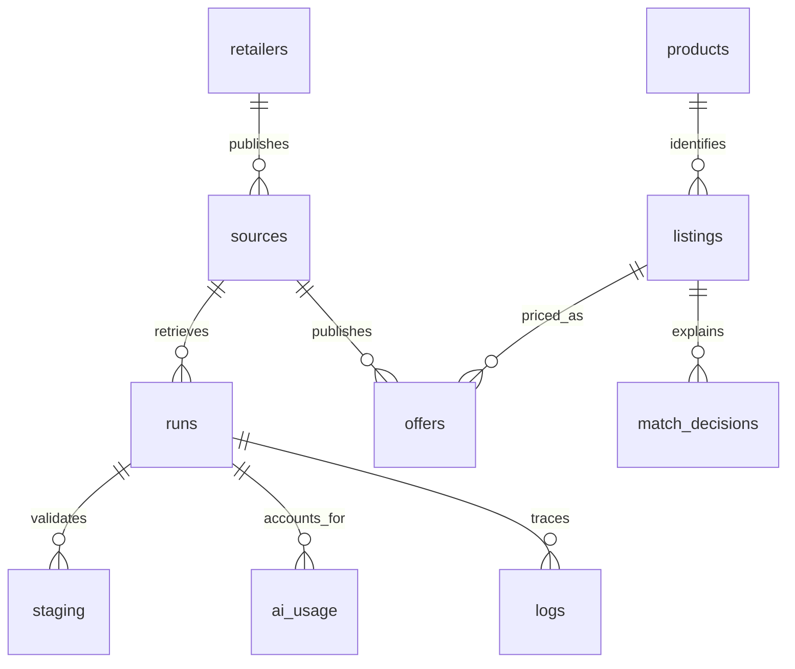

# Working with the catalog database

`offers` contains the currently published observation for each listing and source. A source represents either a published branch catalog or an explicitly labeled shared catalog. A failed import leaves these rows intact. Successful replacement removes disappeared offers; it does not erase the listing or its saved product connection.



A retailer article code belongs to its source namespace. It is not a universal barcode. SPAR's feed even repeats some article codes with different prices; occurrence keys preserve all those rows, with `raw.identity_ambiguous` identifying cases that cannot safely participate in automatic matching.

## Read current offers for a product

Bind the shared product UUID as `$1`. `redirect_id` retains old product references after groups merge. Return `scope` to callers so shared online catalogs are displayed accurately.

```sql
WITH RECURSIVE identity AS (
  SELECT id, redirect_id FROM products WHERE id = $1
  UNION
  SELECT p.id, p.redirect_id
  FROM products p JOIN identity i ON p.id = i.redirect_id
)
SELECT l.name, l.retailer, s.name AS branch_or_catalog, s.scope,
       o.price, o.regular_price, o.promo_price, o.promotion,
       o.available, o.source_updated_at, o.retrieved_at,
       o.source_url, o.run_id
FROM listings l
JOIN offers o ON o.listing_id = l.id
JOIN sources s ON s.id = o.source_id
WHERE s.active
  AND l.product_id = (SELECT id FROM identity WHERE redirect_id IS NULL)
ORDER BY o.price NULLS LAST;
```

Prices are exact MKD decimal values. `NULL` means unknown; it must not become zero. Availability is independently nullable. `unit_price` retains the source's unit-price text, which can require separate interpretation before comparing variable-weight products.

## Find products connected across retailers

```sql
SELECT l.product_id, min(l.name) AS example_name,
       count(DISTINCT l.retailer) AS retailer_count,
       count(*) AS current_offers
FROM listings l
JOIN offers o ON o.listing_id = l.id
JOIN sources s ON s.id = o.source_id
WHERE s.active
GROUP BY l.product_id
HAVING count(DISTINCT l.retailer) > 1;
```

Uncertain listings have their own product identity. This query intentionally excludes those until sufficient evidence connects them.

## Inspect evidence and freshness

`match_decisions` retains the identity hash, method, probability, evidence, prompt version and model. A price-only change does not invalidate `listings.matched_hash`; recurring imports preserve the connection and abstention without making another provider request. Changed descriptive identity creates new matching work. Requests are also cached across branches in `ai_cache`.

`offers.retrieved_at` describes when the observation was imported. `source_updated_at` preserves the retailer's reported time and can be unknown. Stokomak and Žito have observed update labels that advance during page rendering; consult their explicit `timestamp_policy` in configuration. Neither timestamp promises checkout availability.

`offers.source_url` pins publication provenance even if the next discovery finds another dated URL. Join `sources` for the published branch identifier and scope; join `runs` for the checkpoint, attempt count, summary and errors. `logs.run_id` and `logs.correlation_id` locate operational details.

## Operational records

`staging` and `artifacts` are bounded diagnostic data under the configured retention policies. Publication and matching requests share a transaction. Queue delivery, source publication and matching each use database locks; replaying a successful run does not refresh its prices or timestamps.

AI usage records include conservative reservations for interrupted requests. An ingestion budget covers the root run and its descendant jobs, including sibling branches and matching batches. The monthly cap covers all jobs. These are estimated costs using the explicitly configured model rates.

Use `npm run coverage` for a complete source report. Discovered sources, imported catalogs and verified branch coverage are separate measures. Reptil's one imported shared online catalog represents the public links from 30 locations; its branch prices remain unverified.
