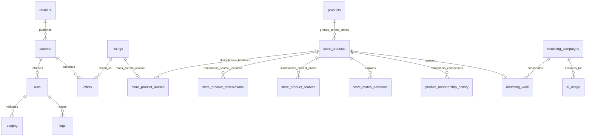

# Working with the catalog database

`offers` contains current published prices for each branch/catalog source. A failed import keeps the previous publication. A complete successful replacement updates existing offers, adds new ones, and removes disappeared offers. Saved product information and matches are retained indefinitely.



`store_products` is unique by **chain + article key + normalized descriptive fingerprint**. Branch copies share that row. Meaningful descriptive changes create another row; old information is retained. A retailer article code is not a universal barcode. Ambiguous source duplicates and conflicting branch descriptions cannot safely grow automatic groups.

`products` remains the shared group table with preserved UUIDs and redirects. New matches update `store_products.group_id`; raw `listings.product_id` is legacy history and must not be used to infer current canonical membership. During migration, application reads include an unmapped legacy fallback through `store_product_browser`.

## Read current offers for a shared product

Bind the shared UUID as `$1`. Redirects retain old product references after groups merge. Return the source `scope` so shared online catalogs are labeled accurately.

```sql
WITH RECURSIVE identity AS (
  SELECT id, redirect_id FROM products WHERE id = $1
  UNION
  SELECT p.id, p.redirect_id
  FROM products p JOIN identity i ON p.id = i.redirect_id
)
SELECT sp.name, sp.retailer, s.name AS branch_or_catalog, s.scope,
       o.price, o.regular_price, o.promo_price, o.promotion,
       o.available, o.source_updated_at, o.retrieved_at,
       o.source_url, o.run_id
FROM store_products sp
JOIN store_product_aliases a ON a.store_product_id = sp.id
JOIN offers o ON o.listing_id = a.listing_id AND o.source_id = a.source_id
JOIN sources s ON s.id = o.source_id AND s.active
WHERE sp.group_id = (SELECT id FROM identity WHERE redirect_id IS NULL)
ORDER BY o.price NULLS LAST;
```

Prices are exact MKD decimals. `NULL` means unknown, not zero. Availability is separately nullable. `unit_price` retains source text and may need further interpretation for variable-weight products. Current prices do not form a historical price series.

## Find groups connected across chains

```sql
SELECT sp.group_id, min(sp.name) AS example_name,
       count(DISTINCT sp.retailer) AS store_count,
       sum(ss.offer_count) AS current_offers
FROM store_products sp
JOIN store_product_sources ss ON ss.store_product_id = sp.id
JOIN sources s ON s.id = ss.source_id AND s.active
GROUP BY sp.group_id
HAVING count(DISTINCT sp.retailer) > 1;
```

Every unmatched store product still has its own group and can be retrieved as a candidate. Several store products can join in one checked operation. Groups with conflicting legacy members are retained with `products.matching_conflict`; they cannot grow automatically.

## Revisions, evidence and freshness

- `store_product_aliases` links each raw source record to its current canonical descriptive revision.
- `store_product_observations` remembers previous raw-record/revision associations and their earlier group.
- `product_membership_history` retains initial and changed shared-group assignments.
- `store_match_decisions` stores source revision, candidate, result, plain-language reason, supported facts/quotes, retrieval reasons, probability, confidence, model and prompt version. `match_decisions` remains intact for legacy history; `matching_decision_browser` combines both.
- `matching_work` stores durable status, lease/token, attempts, campaign and result key. `matching_neighbor_events` prevents repeated neighborhood wakeups for identical changes.
- `ai_cache` reuses actual matching inputs. `ai_usage` records campaign, request key, generation ID, token usage, reported charges and retained uncertain reservations.
- `matching_state` checkpoints bounded backfill. `store_product_sources` summarizes current active price ranges without rewriting branch records for a group merge.

`offers.retrieved_at` is the import time. `source_updated_at` is the retailer-reported time and can be unknown. Stokomak and Žito use observed update labels that advance during page rendering. Neither timestamp guarantees checkout availability.

`offers.source_url` pins publication provenance when discovery later finds another URL. Join `sources` for branch identifiers/scope, `runs` for import checkpoints/errors, and `logs` by run/correlation ID for diagnostics.

## Operational records and spending

Staging/artifact cleanup follows configured retention. Product/match history is not removed when offers disappear. Source publication and durable matching work share a transaction; model calls do not run inside it.

The initial campaign has one $25 allowance across all batches/restarts. Incremental campaigns share $2 each Europe/Skopje calendar month. Evaluation has its own small allowance. Reservations are made before requests and reconciled against reported billing; uncertain requests retain a reservation until investigated. These are application ledger values, not invoices. The former ingestion-root AI budget path is retired.

Use `npm run coverage` for source coverage. Discovered catalogs, imported catalogs, and verified branch prices remain separate measures. Reptil's shared online catalog does not verify physical-branch prices. See [matching.md](matching.md) for activation guards and isolated evaluation instructions.
