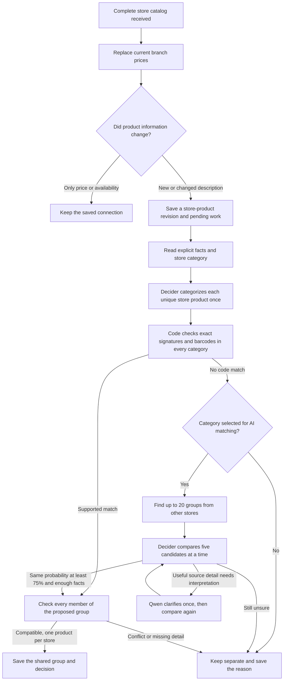

# Matching the same product across stores

## Current delivery state

Production automatic matching and Vercel Gateway calls are **off**. The AI category selection is empty pending review. Existing connections are preserved. Schema migrations through `019` are applied to the application database; they launch no matching or backfill. No full application backfill, import or matching campaign has been started. Read [the category-first implementation guide](category-first-matching.md) for the latest changes and [the prompt files](../prompts/README.md) to review model instructions. The [manual product detail editor](product-detail-editing.md) is available in the dashboard.

The [normalization fixes and independent evaluation](matching-fixes-2026-10-23.md) improved the reviewed development examples from 17 to 75 of 101 pair connections and from zero to 12 complete groups out of 20. The independent sample formed **zero of 13 expected pairs**, exposing insufficient coverage of unfamiliar brands/types and remaining category errors. Both tests made zero incorrect joins, but useful matching on fresh products remains inadequate. Production activation is still blocked by evaluation results. The [original baseline report](matching-evaluation-2026-10-23.md) is preserved. Changing a key alone cannot start matching. The automatic workflow has no approval queue. A separate [manual matching interface](manual-matching.md) now supports saved human connections and remembered separations.

## One product, several stores, many branch prices

For Coca-Cola Original 330 ml in a can, the intended group has one KAM entry, one SPAR entry, one Vero entry, and so on. Each entry can have many physical branches with different prices. Branch copies are never separately sent to AI.



Categories control which products may use paid comparisons; code-based matching remains available in every category. A high model probability is a proposal and still requires enough product information. Conflicting source identities are parked before using models. Saved categories and connections avoid repeating work for unchanged branch copies.

## Code reading order

1. `nextsignal/domain/matching.ts`: input fingerprints, product families, facts with exact source quotes, distinguishing differences, sufficient identity proof and full-group validation. Uses shared legacy-character decoding/transliteration and reviewed local brand/token rules.
2. `nextsignal/services/matching-repository.ts`: canonical records and aliases, resumable migration, current source-price summaries, candidate search, work claims, campaigns, safe group commits and history.
3. `nextsignal/services/ai-gateway.ts`: authenticated native HTTP, response schemas, independent decision questions, optional extraction, cache and spending reservations. Secrets stay server-side.
4. `nextsignal/services/matching-workflow.ts`: connects the stages without SQL or provider-specific response parsing. `matching.ts` is its compatibility entry point.
5. `nextsignal/services/catalog-repository.ts`: `publishCatalog` writes source changes and pending work in the publication transaction.
6. `nextsignal/processes/recurring/catalog.ts` and `business/catalog.ts`: disabled-by-default automatic launch and queue execution guards.
7. `nextsignal/services/product-browser.ts`, `dashboard-read.ts` and `app/_components/dashboard/matching-progress.tsx`: readable facts/history, cross-store groups, campaign controls and spending.
8. `nextsignal/services/matching-prompts.ts` and `prompts/`: startup-validated external instructions, store/category guidance and content hashes archived with each decision.

## Facts and candidate decisions

Rules read explicit amounts, units, pack counts, barcodes, reviewed brands, variants, containers and selected family details. Quantities use exact decimal arithmetic. Diaper suitability weights are not package weights. Produce needs stated type, variety and sale unit; known grade/origin conflicts prevent connection. Unknown or unsupported distinctions remain unknown.

`nextsignal/domain/product-facts.ts` keeps reviewed comparable values separate from original evidence: for example, НУТЕЛА/Nutela/Nutella share a brand value while their source quotes remain unchanged. Generic product type, product range, flavour/fragrance, whole/ground processing and cosmetic shade have separate fields. Name rules take precedence over misleading ingredient/category words, such as apple-scented dishwashing liquid. The reviewed type vocabulary is intentionally conservative; an unrecognized free-text type cannot establish a match or prove a type conflict by itself. Supporting more families requires further evaluation.

`nextsignal/domain/clarification.ts` validates each requested AI fact independently. Unsupported fields are logged and discarded while good fields survive. Amount and unit are validated as one source-supported fact and converted together. Canonicalization happens after literal source validation. Derived facts refresh only for work being processed; candidate/group checks use the same pure rules without mutating records during reads. Changed request inputs and relevant prompt contents invalidate affected request caches without resetting completed work.

Candidate retrieval searches other chains through indexed names, reviewed brands, amounts, validated barcodes and exact local signatures. It considers unmatched products and existing groups, collapses candidates already in the same group, and keeps at most 20 groups. It records deterministic retrieval reasons and scores.

For selected categories, Perplexity Decider V1.2 answers a separate typed choice question for each of five candidate groups: **same**, **different**, or **not enough information**. SPAR and Vero can both answer “same” for KAM. An AI “same” requires probability at least **0.75**, sufficient supported identity facts, no explicit differences, and full-group compatibility. Provider confidence is a separate field. Missing information never becomes a proven permanent difference. The lower cutoff still needs a reviewed live evaluation before activation.

Every valid unique store product uses Decider classification once, with a separate 0.80 category acceptance threshold and alternative hints. Saved unchanged classifications are reused. `matching.ai_categories` explicitly selects which labels may use comparisons and Qwen. Other labels remain unmatched unless code establishes a safe connection. Qwen3.7 Flash is limited to one targeted clarification round where source text contains a useful answer. Its strict output includes a source field and exact quote for every fact. Code verifies allowed fields, source identifiers, literal quotes and numeric conversions. It does not repeatedly ask models to guess omitted information. Instructions live in external prompt files; only relevant store/category guides enter each request, and their source snapshots are preserved by hash.

The final short transaction checks work ownership, active sources, product/group versions, every pair of group members and chain uniqueness. It can create a group, enlarge it, or merge compatible existing groups. Conflicts remain separate. Slow HTTP requests never hold database transactions open.

## What happens on later imports

| Source change                                          | Result                                                                  |
| ------------------------------------------------------ | ----------------------------------------------------------------------- |
| Same name/information, changed price or promotion      | Replace current offer; reuse the match; no matching AI call             |
| Same product in another branch                         | Attach the observation to the existing store product                    |
| Product disappears from a successful complete catalog  | Remove that branch's offer; retain product, group and history           |
| Unchanged product returns                              | Restore offers and reuse its saved connection                           |
| Meaningful descriptive change, such as 330 ml → 500 ml | Save another revision and recheck it; preserve the old revision/history |
| Branches disagree about one article                    | Flag the conflict and keep matching separate                            |
| Useful new counterpart appears                         | Reopen affected unresolved neighbors through deduplicated events        |
| Worker restarts                                        | Recover expired claims and continue unfinished items                    |
| Source/group changes while AI is answering             | Save a stale outcome; do not apply the answer to current groups         |

Spelling/case changes that normalize to the same input reuse the revision. Prices, branch IDs and run IDs are excluded from provider cache inputs. Cache keys include actual descriptive inputs, candidate revisions, model and relevant prompt content. Classification keys exclude the AI category selection and matching cutoff. Unrelated catalog updates do not reset unresolved products.

## Budgets and controls

All required values live in `config/default.json` and `nextsignal/config.ts`; root `NEXTSIGNAL_` environment overrides use double underscores. `.env.production.local.example` documents the current switches. The old `matching.ai` block remains accepted for environment compatibility only; its OpenAI client has been retired.

- Initial database campaign: one lifetime **$25** allowance, shared across every batch and restart.
- Subsequent new/changed products: one **$2/calendar month** allowance across incremental campaigns, using Europe/Skopje.
- Explicit isolated paid evaluations: separate **$0.25/evaluation** allowance.
- Reserve before HTTP; reconcile actual reported usage afterward. Uncertain billing keeps its reservation and request key, pauses progress, and prevents silent duplicate calls. Usage is not an invoice and exactly-once external API execution is not promised.

Tasks owns expensive actions. “Process pending matches” queues promptly; it does not reset existing records. Pause/resume retains progress, cache and connections. Status includes waiting, processed, connected, unresolved, outside selected categories and deferred products plus campaign spending. Newly selected excluded products can be requeued in bounded chunks without reclassifying them. Browser refresh is read-only. JSON stays in Logs.

Both `matching.automatic_enabled` and `matching.gateway.enabled` must be deliberately enabled for automatic paid work. Keep both false until review. Budget exhaustion pauses work rather than dropping it. Incremental budget pauses can resume after a local-calendar month changes; initial allowance never resets with a month or batch. Provider/uncertain-billing cases need inspection before resume. Billing reconciliation currently requires an operator to check the saved generation/request metadata; no automatic ledger-repair tool is provided.

## Operational logs

See [logging.md](logging.md) for event names, severity, correlation IDs, billing diagnostics and debug tracing. Matching, campaign, Gateway and publication logs use the registered NextSignal adapter. Commit events are logged after their transactions; per-product details stay at debug level.

## Small, isolated verification

```sh
npm run check
npm test
npm run build
# Constructed controls only, separate catalog_matching_test database, zero paid calls:
npm run matching:evaluate
npm run matching:evaluate -- --holdout
```

The 30 constructed controls cover 10 positive connections, 10 explicit differences and 10 missing-information cases. They verify plumbing and rules; they are not manually labeled random production products and do not establish real-world AI accuracy.

The approved real-store diagnostic fixture is `tests/fixtures/real-store-matching-evaluation.json`. See the dated report above before rerunning it. Evaluations drain neighbor follow-ups inside the original campaign and its allowance; they mark the campaign completed when no work remains.

Prepare the agreed random review set only when ready:

```sh
# Read-only production sampling: 10 per chain, counterparts, plus 30 controls.
# Does not start matching or call a provider. Does query the catalog.
npm run matching:sample -- review-1 .data/matching-evaluation/review-1.json
# Smaller first review: two products per chain and five suggestions each.
NEXTSIGNAL_MATCHING__EVALUATION__SAMPLE_PER_STORE=2 NEXTSIGNAL_MATCHING__CANDIDATE_LIMIT=5 npm run matching:sample -- review-small .data/matching-evaluation/review-small.json
# Review the generated Markdown and label expected/reviewed fields in its JSON.
# Evaluation rejects unreviewed cases. All group members must share one split.
npm run matching:evaluate -- --dataset .data/matching-evaluation/review-1.json
# Explicit opt-in only after reviewing the dataset/key and agreeing to spend:
npm run matching:evaluate -- --dataset .data/matching-evaluation/review-1.json --paid
```

Check the sampler's printed output path; it refuses to overwrite existing files. The harness seeds only its disposable evaluation database, then exercises actual retrieval, provider decisions (only with `--paid`), validation and grouping. Reports show correct/incorrect joins, unresolved positives, positive-candidate coverage, calls, cost and representative names/reasons. It requires useful positive connections as well as zero incorrect joins. Keep entire groups together across development and untouched evaluation splits. Sampling never starts production matching; paid evaluation requires the explicit opt-in above.

Sampling uses a read-only transaction and also works before migration `016`: it reads the existing compact `catalog_browser` when the new store-product view is absent. It does not apply migrations or backfill the application database. Suggested counterparts are only a review aid; independently search for missing counterparts before using a dataset to measure retrieval coverage. Hand-selected diagnostic cases help find bugs but cannot establish overall accuracy.

Fresh deployment setup is separate from activation:

```sh
# Applies schema only; normal deployment migration command.
npm run migrate
```

Start by importing a small selected catalog through Tasks. Publication creates its
store-product records automatically; no preparation or backfill action is needed.
Categorization and matching are separately reviewed tasks until their automation
is deliberately enabled. Normal tasks select imported store products directly;
they do not convert old database records as a side effect.
