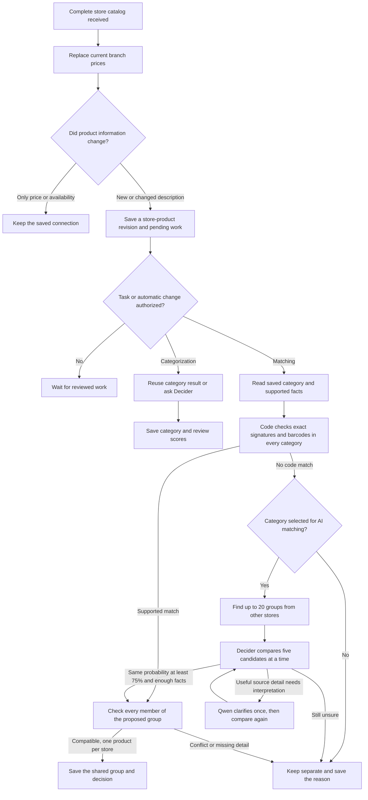

# Matching the same product across stores

## Activation and saved work

Fresh deployments use manual operation modes with AI permission off. The saved
Settings record controls later activation; this document does not assert the
current settings of a running deployment. Categorization, code matching and
AI-assisted matching are separately reviewed tasks. Category selection, product
limits, allowances and the reviewed settings revision are captured before work
starts. Setting an API key alone does not authorize a task or full campaign.

Publication prepares unique store products directly. There is no migration or
backfill action required before categorization or matching. Saved connections,
manual corrections and decision history survive removed offers and restarts.

Read [the category-first implementation guide](category-first-matching.md),
[operational controls](task-controls.md), [brand reference data](brands.md) and
[the prompt files](../prompts/README.md) for the current implementation. Dated
[evaluation reports](matching-evaluation-2026-10-23.md) and
[normalization investigations](matching-fixes-2026-10-23.md) describe those
specific datasets and code versions; they are not a general accuracy guarantee
or a statement that production automation is enabled.

## One product, several stores, many branch prices

For Coca-Cola Original 330 ml in a can, the intended group has one KAM entry, one SPAR entry, one Vero entry, and so on. Each entry can have many physical branches with different prices. Branch copies are never separately sent to AI.



Unavailable products stay outside categorization and matching. If an unchanged product becomes available again, it reuses saved results; any still-pending category or matching work may run only under the applicable task/automation permission. Availability changes do not create another descriptive product revision.

Categories control which products may use paid comparisons; code-based matching remains available in every category. A high model probability is a proposal and still requires enough product information. Conflicting source identities are parked before using models. Saved categories and connections avoid repeating work for unchanged branch copies.

## Code reading order

1. `nextsignal/domain/matching.ts`: input fingerprints, product families, facts with exact source quotes, distinguishing differences, sufficient identity proof and full-group validation. Uses shared legacy-character decoding/transliteration and reviewed local brand/token rules.
2. `nextsignal/services/matching-repository.ts`: canonical records and aliases, current source-price summaries, candidate search, work claims, spending campaigns, safe group commits and history.
3. `nextsignal/services/ai-gateway.ts`: authenticated native HTTP, response schemas, independent decision questions, optional extraction, cache and spending reservations. Secrets stay server-side.
4. `nextsignal/services/matching-workflow.ts`: connects product-processing stages without SQL or provider-specific response parsing. `task-products.ts` executes them within the task's captured limits and current permissions; there is no run-based compatibility entry point.
5. `nextsignal/services/catalog-repository.ts`: `publishCatalog` writes source changes and pending work in the publication transaction.
6. `nextsignal/services/tasks.ts`, `task-settings.ts` and `processes/distributed/tasks.ts`: reviewed task creation, schedule/change authorization, checkpoints, pause/resume and queue dispatch.
7. `nextsignal/services/product-browser.ts`, `dashboard-read.ts` and `app/_components/dashboard/tasks.tsx`: readable facts/history, cross-store groups, task controls and spending.
8. `nextsignal/services/matching-prompts.ts` and `prompts/`: startup-validated external instructions, store/category guidance and content hashes archived with each decision.

## Facts and candidate decisions

Rules read explicit amounts, units, pack counts, barcodes, reviewed brands, variants, containers and selected family details. Quantities use exact decimal arithmetic. Diaper suitability weights are not package weights. Produce needs stated type, variety and sale unit; known grade/origin conflicts prevent connection. Unknown or unsupported distinctions remain unknown.

`nextsignal/domain/product-facts.ts` keeps reviewed comparable values separate from original evidence: for example, НУТЕЛА/Nutela/Nutella share a brand value while their source quotes remain unchanged. Generic product type, product range, flavour/fragrance, whole/ground processing and cosmetic shade have separate fields. Name rules take precedence over misleading ingredient/category words, such as apple-scented dishwashing liquid. The reviewed type vocabulary is intentionally conservative; an unrecognized free-text type cannot establish a match or prove a type conflict by itself. Supporting more families requires further evaluation.

`nextsignal/domain/clarification.ts` validates each requested AI fact independently. Unsupported fields are logged and discarded while good fields survive. Amount and unit are validated as one source-supported fact and converted together. Canonicalization happens after literal source validation. Derived facts refresh only for work being processed; candidate/group checks use the same pure rules without mutating records during reads. Changed request inputs and relevant prompt contents invalidate affected request caches without resetting completed work.

Candidate retrieval searches other chains through indexed names, reviewed brands, amounts, validated barcodes and exact local signatures. It considers unmatched products and existing groups, collapses candidates already in the same group, and keeps at most 20 groups. It records deterministic retrieval reasons and scores.

For selected categories, Perplexity Decider V1.2 answers a separate typed choice question for each of five candidate groups: **same**, **different**, or **not enough information**. SPAR and Vero can both answer “same” for KAM. An AI “same” requires probability at least **0.75**, sufficient supported identity facts, no explicit differences, and full-group compatibility. Provider confidence is a separate field. Missing information never becomes a proven permanent difference. Both thresholds are editable operational settings; any acceptance still requires source-supported facts and full-group validation.

An authorized categorization task uses Decider for unique store products without reusable results, with an initial 0.80 category acceptance threshold and saved alternative scores. Saved unchanged classifications are reused. AI matching uses saved categories: manual tasks capture their own selection and automatic matching uses the selection in operational settings. Uncategorized products wait for categorization rather than triggering it implicitly. Other labels remain unmatched unless code establishes a safe connection. Qwen3.7 Flash is limited to one targeted clarification round where source text contains a useful answer. Its strict output includes a source field and exact quote for every fact. Code verifies allowed fields, source identifiers, literal quotes and numeric conversions. It does not repeatedly ask models to guess omitted information. Instructions live in external prompt files; only relevant store/category guides enter each request, and their source snapshots are preserved by hash.

The final short transaction checks work ownership, active sources, product/group versions, every pair of group members and chain uniqueness. It can create a group, enlarge it, or merge compatible existing groups. Conflicts remain separate. Slow HTTP requests never hold database transactions open.

## What happens on later imports

| Source change                                          | Result                                                                  |
| ------------------------------------------------------ | ----------------------------------------------------------------------- |
| Same name/information, changed price or promotion      | Replace current offer; reuse the match; no matching AI call             |
| Same product in another branch                         | Attach the observation to the existing store product                    |
| Product disappears from a successful complete catalog  | Remove that branch's offer; retain product, group and history           |
| Unchanged product returns                              | Restore offers and reuse its saved connection                           |
| Meaningful descriptive change, such as 330 ml → 500 ml | Save another revision and recheck it; preserve the old revision/history |
| Branches disagree about one article                    | Flag the conflict and keep matching separate                            |
| Useful new counterpart appears                         | Reopen affected unresolved neighbors through deduplicated events        |
| Worker restarts                                        | Recover expired claims and continue unfinished items                    |
| Source/group changes while AI is answering             | Save a stale outcome; do not apply the answer to current groups         |

Spelling/case changes that normalize to the same input reuse the revision. Prices, branch IDs and run IDs are excluded from provider cache inputs. Cache keys include actual descriptive inputs, candidate revisions, model and relevant prompt content. Classification keys exclude the AI category selection and matching cutoff. Unrelated catalog updates do not reset unresolved products.

## Budgets and controls

Deployment values and initial task settings live in `config/default.json` and `nextsignal/config.ts`; root `NEXTSIGNAL_` environment overrides use double underscores. Saved operational settings in PostgreSQL govern reviewed tasks and automation without a restart. `.env.production.local.example` documents deployment configuration. Vercel Gateway is the only production AI integration: Perplexity Decider handles classification/comparison, and Qwen Flash handles optional targeted clarification. Removed configuration fields are rejected; there is no retired model compatibility block.

- Initial database campaign: one lifetime **$25** allowance, shared across every batch and restart.
- Subsequent new/changed products: one **$2/calendar month** allowance across incremental campaigns, using Europe/Skopje.
- Explicit isolated paid evaluations: separate **$0.25/evaluation** allowance.
- Reserve before HTTP; reconcile actual reported usage afterward. Uncertain billing keeps its reservation and request key, pauses progress, and prevents silent duplicate calls. Usage is not an invoice and exactly-once external API execution is not promised.

Run Tasks owns expensive actions. A reviewed matching request queues promptly and does not reset existing records. Pause/resume retains progress, cache and connections. Status includes waiting, processed, connected, unresolved and deferred products plus spending. Deliberate recheck tasks can revisit selected products using saved categories and cache responses; changing categories alone does not sweep completed work. Browser refresh is read-only. JSON stays in Logs.

Settings owns automatic matching and AI permission; fresh deployments keep both manual/off until deliberately configured. Isolated evaluation commands separately require the Gateway enablement switch plus an explicit `--paid` argument. Budget exhaustion pauses work rather than dropping it. Incremental budget pauses may be explicitly resumed when the local-calendar allowance permits; a month change does not bypass a paused task. The initial allowance never resets with a month or batch. Provider/uncertain-billing cases need inspection before resume. Billing reconciliation currently requires an operator to check the saved generation/request metadata; no automatic ledger-repair tool is provided.

## Operational logs

See [logging.md](logging.md) for event names, severity, correlation IDs, billing diagnostics and debug tracing. Matching, campaign, Gateway and publication logs use the registered NextSignal adapter. Commit events are logged after their transactions; per-product details stay at debug level.

## Small, isolated verification

```sh
npm run check
npm test
npm run build
# Constructed controls only, separate catalog_matching_test database, zero paid calls:
npm run matching:evaluate
npm run matching:evaluate -- --holdout
```

The 30 constructed controls cover 10 positive connections, 10 explicit differences and 10 missing-information cases. They verify plumbing and rules; they are not manually labeled random production products and do not establish real-world AI accuracy.

The approved real-store diagnostic fixture is `tests/fixtures/real-store-matching-evaluation.json`. See the dated report above before rerunning it. Evaluations drain neighbor follow-ups inside the original campaign and its allowance; they mark the campaign completed when no work remains.

Prepare the agreed random review set only when ready:

```sh
# Read-only production sampling: 10 per chain, counterparts, plus 30 controls.
# Does not start matching or call a provider. Does query the catalog.
npm run matching:sample -- review-1 .data/matching-evaluation/review-1.json
# Smaller first review: two products per chain and five suggestions each.
NEXTSIGNAL_MATCHING__EVALUATION__SAMPLE_PER_STORE=2 NEXTSIGNAL_MATCHING__CANDIDATE_LIMIT=5 npm run matching:sample -- review-small .data/matching-evaluation/review-small.json
# Review the generated Markdown and label expected/reviewed fields in its JSON.
# Evaluation rejects unreviewed cases. All group members must share one split.
npm run matching:evaluate -- --dataset .data/matching-evaluation/review-1.json
# Explicit opt-in only after reviewing the dataset/key and agreeing to spend:
npm run matching:evaluate -- --dataset .data/matching-evaluation/review-1.json --paid
```

Check the sampler's printed output path; it refuses to overwrite existing files. The harness seeds only its disposable evaluation database, then exercises actual retrieval, provider decisions (only with `--paid`), validation and grouping. Reports show correct/incorrect joins, unresolved positives, positive-candidate coverage, calls, cost and representative names/reasons. It requires useful positive connections as well as zero incorrect joins. Keep entire groups together across development and untouched evaluation splits. Sampling never starts production matching; paid evaluation requires the explicit opt-in above.

Sampling uses a read-only transaction. It does not apply migrations, import products or prepare old records in the application database. Suggested counterparts are only a review aid; independently search for missing counterparts before using a dataset to measure retrieval coverage. Hand-selected diagnostic cases help find bugs but cannot establish overall accuracy.

Fresh deployment setup is separate from activation:

```sh
# Applies schema only; normal deployment migration command.
npm run migrate
```

Start by importing a small selected catalog through Tasks. Publication creates its
store-product records automatically; no preparation or backfill action is needed.
Categorization and matching are separately reviewed tasks until their automation
is deliberately enabled. Normal tasks select imported store products directly;
they do not convert old database records as a side effect.
