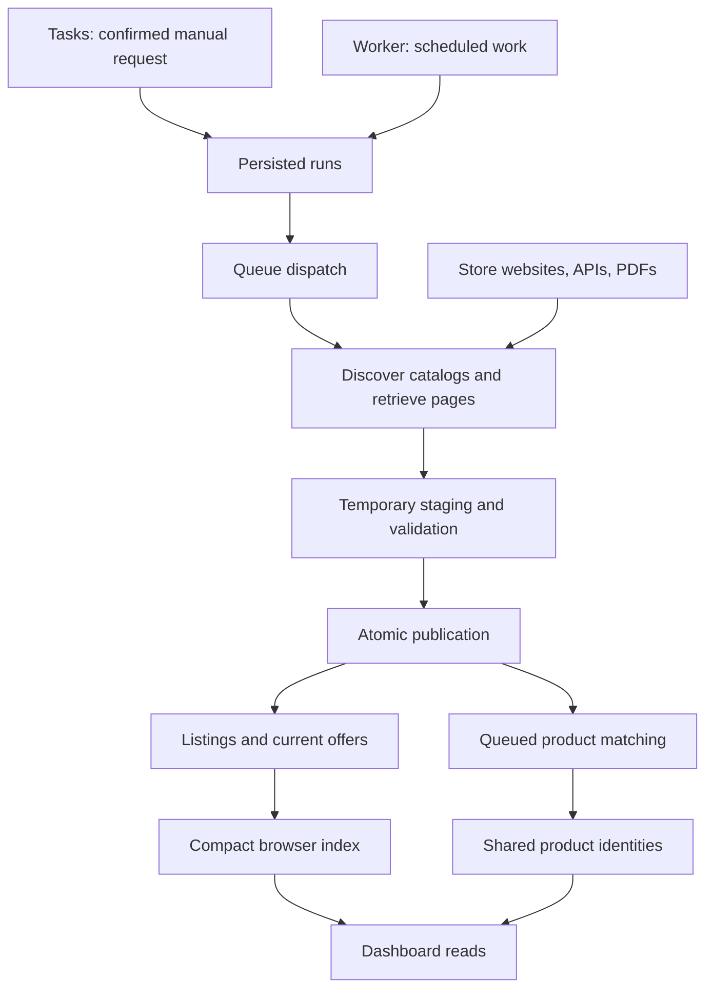

# Reading the MKD price aggregator

This is a reading companion to the current code, starting from commit `08bcf76`. The inventory below covers all 173 files in that commit. Read the pipeline first; use the file inventory as a reference rather than reading every UI primitive in sequence.

The descriptions explain implemented behavior. Questions marked **Decision to check** are product choices to compare with your intentions, not changes already made.

## 1. What runs, and where the data lives

There are three long-running pieces and one startup helper:

| Piece             | Responsibility                                                      | Starting point                                                             |
| ----------------- | ------------------------------------------------------------------- | -------------------------------------------------------------------------- |
| Web               | Serves the dashboard and authenticated APIs.                        | [app/page.tsx](../app/page.tsx), [app/dashboard.tsx](../app/dashboard.tsx) |
| Worker            | Processes queued tasks and scheduled work.                          | [worker/index.ts](../worker/index.ts)                                      |
| PostgreSQL        | Stores current catalogs, products, prices, jobs, and audit records. | [compose.yaml](../compose.yaml), [migrations/](../migrations/)             |
| Migration service | Applies database schema changes before application startup.         | [scripts/migrate.ts](../scripts/migrate.ts)                                |

The main database is in Docker’s `postgres-data` volume. It is not stored in Git or in the `migrations` directory. `.data` contains local diagnostics, reports, screenshots, and any backups/scripts created there; it is not the authoritative database. The other persistent Docker volumes retain web/worker log spools.

The scheduler is independent of visiting the dashboard. Moving manual actions into Tasks does not disable scheduled imports, post-import matching, or matching requested by local-index updates.

## 2. The core vocabulary

| Name          | Meaning in this application                                             | Example                                                               |
| ------------- | ----------------------------------------------------------------------- | --------------------------------------------------------------------- |
| Retailer      | A supermarket company.                                                  | KAM or SPAR.                                                          |
| Source        | One published branch catalog, or an explicitly shared retailer catalog. | KAM Avtokomanda’s PDF.                                                |
| CatalogRow    | One row parsed from a retailer response, before publication.            | Original name, article key, price, availability, raw source fields.   |
| Listing       | A source-namespaced product identity.                                   | One branch’s published article row.                                   |
| Offer         | That listing’s current published observation for a source.              | 77.00 MKD, availability, retrieval time, and source URL.              |
| Product       | A shared identity to which listings can connect.                        | The same exact sellable item across stores or branches.               |
| Run           | A persisted unit of discovery, catalog import, or matching work.        | One catalog import with status, checkpoint, attempts, and errors.     |
| Browser index | A smaller derived representation for display.                           | One representative per retailer + article key + descriptive identity. |

Three branch listings can have three prices but one shared product after matching. Before a match, each new descriptive identity receives its own product UUID. Therefore, a record in `products` does not by itself prove a cross-store match. “Matched across stores” requires distinct retailers.

## 3. Start reading here: one import from request to prices

Follow these functions in this order. The names below are search terms inside the linked files.

1. **Which behavior is configured?** Read [config/default.json](../config/default.json), then the provider wiring at the bottom of [nextsignal/config.ts](../nextsignal/config.ts). Root environment files override JSON through `NEXTSIGNAL_` keys; `__` separates nested keys. Missing required settings fail validation.
2. **What does pressing Start import do?** Read `startTask` in [app/dashboard.tsx](../app/dashboard.tsx), the import API process in [processes/api/operations.ts](../nextsignal/processes/api/operations.ts), and `requestIngestion` in [services/operations.ts](../nextsignal/services/operations.ts). It creates discovery runs. The HTTP request does not download every catalog.
3. **How does work begin?** Read `catalogTick` in [recurring/catalog.ts](../nextsignal/processes/recurring/catalog.ts), `dispatchPending` in [distributed/jobs.ts](../nextsignal/processes/distributed/jobs.ts), then `executeLocked` / `performRun` in [business/catalog.ts](../nextsignal/processes/business/catalog.ts).
4. **Where are branch catalogs found?** Read `discover` in [services/importers.ts](../nextsignal/services/importers.ts). The retailer-specific branches extract catalog URLs and source scope. `saveDiscovery` in [catalog-repository.ts](../nextsignal/services/catalog-repository.ts) saves them and requests a catalog import for each discovered source. Previously known sources absent from a successful discovery become inactive.
5. **How is one catalog downloaded?** Read [business/retrieve.ts](../nextsignal/processes/business/retrieve.ts), then `retrieve` in [services/importers.ts](../nextsignal/services/importers.ts). HTTP and API sources are paged; KAM PDFs are converted to text with `pdftotext`.
6. **What is extracted?** Read the retailer’s parser in [services/parsers.ts](../nextsignal/services/parsers.ts), alongside `CatalogRow` in [domain/types.ts](../nextsignal/domain/types.ts). Inspect which source field becomes the selling price, article key, category, availability, or promotion.
7. **When can incomplete data affect current prices?** Read `stagePage`, `shouldConfirm`, and `publishCatalog` in [catalog-repository.ts](../nextsignal/services/catalog-repository.ts). Pages and checkpoints are saved together. Publication checks completion/counts and happens in one transaction. Empty or significantly smaller catalogs need another identical retrieval before replacing current offers.
8. **How is identity decided?** Read `identity` and `attributes` in [domain/normalize.ts](../nextsignal/domain/normalize.ts), then the `prepared` mapping and listing upsert in `publishCatalog`. Unchanged descriptive identity preserves the live product assignment and matching state. Changed descriptive identity gets a new product UUID.
9. **What is finally stored?** Near the end of `publishCatalog`, existing offers for this source are deleted and the new offers are inserted. The run/source publication metadata and post-import matching request are committed in the same transaction.

**Decision to check: price history.** There is no append-only price-history table. `offers` is the latest successful publication for each source/listing. Audit records and short-lived staging do not provide a durable historical price series.

**Decision to check: refresh granularity.** `saveDiscovery` queues an import for every discovered catalog in the selected retailer scope. It does not skip catalogs just because their last import is still within the freshness window. Freshness is an indicator, not an incremental-download rule.

**Decision to check: retailer-specific price handling.** Decimal values are strings until PostgreSQL stores exact numerics. `money()` returns `null` for unparseable amounts. The configured `preserve_unknown` policy is used by the generic HTML-table parser; it is not a universal promise that every parser accepts invalid selling prices. SPAR rejects invalid selling prices; KAM has its own row detection/validation; Reptil can deliberately retain an unknown price for a variable-price product.

**Decision to check: disappearing data.** Successful publication removes offers for rows no longer in that source. Listings and their saved product connections remain. Successful discovery can also deactivate sources that disappear from the retailer’s published catalog list. A failed retrieval retains the previous successful offers.

The row-count reduction confirmation protects individual catalog publication. There is no analogous confirmation step in `saveDiscovery` before deactivating a reduced set of discovered branches; discovery requires a nonempty source list, but a partial nonempty list is a separate case to consider.

## 4. Read the matching rules separately

Start at `matchBatch` in [services/matching.ts](../nextsignal/services/matching.ts), then read `unmatchedListings`, `matchListing`, and `commitDecision`.

- A validated matching barcode can authorize a connection if known attributes do not conflict.
- Configured local rules can authorize a connection when the recognized brand, quantity/unit, and remaining canonical tokens agree. Read `localRuleKey` in [domain/local-matching.ts](../nextsignal/domain/local-matching.ts). Similar-looking names alone do not authorize this method.
- A separate fingerprint method requires complete attributes, identical normalized names, and identical attributes apart from barcode.
- Optional AI can extract missing attributes and compare candidate pairs. Read [services/ai.ts](../nextsignal/services/ai.ts) only after understanding the deterministic methods and conflict checks.
- Known conflicts or ambiguous identities block linking. Candidate search is bounded; failing to find a match does not prove two products differ.
- Before merging, `commitDecision` rechecks identities and the compatibility of all group members under database locks. It redirects merged product UUIDs and records evidence.

**Decision to check: what counts as unchanged?** `identity()` hashes original name, description, category, barcode, and the duplicate-ambiguity flag. Price, promotion, availability, and retrieval time are excluded. A price-only change does not repeat an already saved matching decision. A source-name correction can change identity even when it describes the same real-world item.

**Decision to check: revisiting old decisions.** A completed no-match decision usually saves `matched_hash = identity_hash`; merely waiting the retry interval does not clear that equality. Deferred work stays eligible after its delay. New/changed identities can be processed, and the explicit unresolved retry clears saved unresolved states. Rule-key version changes rebuild the local index; they do not by themselves clear every saved matching result.

**Decision to check: the acceptance threshold.** The configured `0.99` is a score threshold used by the implementation, not a demonstrated 99% accuracy guarantee. The current candidate limit is 10. Many items can remain separate, particularly with AI off and a finite brand dictionary.

**Decision to check: the manual matching request.** `retryMatching` in [services/operations.ts](../nextsignal/services/operations.ts) first performs a potentially large SQL update reopening unresolved listings, and only then creates a matching run. That preparation happens during the request. Matching batches subsequently run in the worker. Existing matched connections are preserved.

## 5. Spelling, identifiers, scope, and timestamps

- [domain/name-encoding.ts](../nextsignal/domain/name-encoding.ts) decodes conservative legacy punctuation such as `^ → Ч`, `[ → Ш`, and `] → Ќ` in letter contexts. Original source names remain stored. [domain/normalize.ts](../nextsignal/domain/normalize.ts) creates a lowercase Latin search/matching form; it does not replace the display name with Cyrillic.
- Source article keys are scoped by retailer and source namespace. They are not assumed to be universal barcodes.
- Under `occurrence` identity policy, repeated keys receive occurrence suffixes. Repeated identities are marked ambiguous and kept out of automatic matching. Under `strict`, conflicting duplicate keys fail rather than being silently combined. Inspect `stagePage` to see the exact distinction.
- Reptil discovery groups locations that link to the same shared online catalog. One shared source is not verified individual-branch pricing.
- `retrieved_at` means when this application imported the observation; `source_updated_at` is the retailer’s reported timestamp. Stokomak and Žito use an `observed` policy because their displayed time is not treated as a stable snapshot identifier. Other configured sources use `snapshot` checks where timestamps are available.

## 6. Understand the display layer last

Read [catalog-browser.ts](../nextsignal/services/catalog-browser.ts), migrations [010](../migrations/010_catalog_browser.sql) and [012](../migrations/012_name_quality.sql), then [dashboard-read.ts](../nextsignal/services/dashboard-read.ts) and [product-browser.ts](../nextsignal/services/product-browser.ts).

`catalog_browser` compresses branch copies into representative retailer articles. It is refreshed after active discovery/catalog imports finish, so the dashboard may show a previous completed index while authoritative offers already contain newer prices. The dashboard returns the index refresh time and pending-refresh state.

All products groups these representatives by current product assignment. Store/name filters choose whole groups; their returned connected stores and price range still describe the complete selected group. A catalog drill-down reads that catalog’s price, rather than presenting the cheapest branch price as if it were local.

The usable-name filter hides names without a letter after normalization; it does not delete those source rows. Product-detail listing rows use browser representatives, while price observations use broader current-offer lookups. An empty Store products section therefore does not establish that the source offered no such article. This is the area to inspect for the previously discussed representative-index detail issue.

The previously observed All products performance check exceeded its five-second target. Treat that as a separate display/query limitation, not proof that an import or matching task started when you reloaded a view.

## 7. Settings observed while preparing this guide

The following non-secret values were resolved by the local configuration loader on 22 October 2026. This reads configuration without running a worker or importing data. Container processes keep the configuration they started with; changed environment values require recreation, and changed baked-in JSON requires rebuilding the affected image.

| Setting                          | Resolved local value                        | Meaning                                                                             |
| -------------------------------- | ------------------------------------------- | ----------------------------------------------------------------------------------- |
| Timezone                         | Europe/Skopje                               | Retailer schedule and source wall-clock interpretation.                             |
| Global import cron               | `0 12 * * 1`                                | Monday at 12:00 local time.                                                         |
| Per-store cron                   | `null` for all nine                         | Uses the global schedule.                                                           |
| Worker tick                      | 60 seconds; startup tick enabled            | Checks due work and performs the other recurring maintenance steps.                 |
| Catch-up                         | Enabled                                     | Missed due work can be queued after downtime, subject to active-import checks.      |
| Matching                         | Enabled                                     | Successful imports can request matching.                                            |
| Local matching                   | Enabled; 19 configured brands               | Conservative exact canonical signatures.                                            |
| AI matching                      | Disabled                                    | The current matching path does not send paid AI requests.                           |
| Matching batch / candidate limit | 50 / 10                                     | Bounds work selection and candidates per listing.                                   |
| Matching threshold               | 0.99                                        | Acceptance cutoff, not an empirical guarantee.                                      |
| Reduction ratio                  | 0.7                                         | Fewer than 70% of prior rows requires confirmation; empty catalogs also require it. |
| Freshness window                 | 168 hours                                   | Seven days for the freshness indicator.                                             |
| Diagnostic retention             | Artifacts 24h; staging 48h                  | These are not permanent price history.                                              |
| Local AI dollar caps             | $0.10 per ingestion family; $0.25 per month | Overrides read from the local configuration; AI remains disabled.                   |

## 8. How to read a NextSignal process

`app.ts` wires the pieces. A process has a stable name; `auth` checks whether it may run, `validate` checks its input, and `handle` describes its application flow. `ctx.services` accesses the registered database/provider functions. `ctx.mediator.dispatch("name", input)` calls another named process; read that target to keep following the path. `value(data)` / `ok()` are successful result envelopes; a failed envelope retains fault information.

The process files describe orchestration. Most exact database and data-transformation behavior is in `services` and `domain`. `adapters` connect infrastructure such as pg-boss to the framework. `@/` means the repository root, so `@/nextsignal/services/database` refers to `nextsignal/services/database.ts`.

## 9. Folder map

| Folder                  | Read it for                                                                                                 |
| ----------------------- | ----------------------------------------------------------------------------------------------------------- |
| `nextsignal/domain/`    | Vocabulary and pure business rules: money, names, attributes, identity, and local signatures.               |
| `nextsignal/services/`  | Actual source requests, SQL, publication, matching, and reads. This is the core for checking data behavior. |
| `nextsignal/processes/` | How API calls, queued work, business operations, and scheduled ticks connect.                               |
| `nextsignal/adapters/`  | Authentication, logs, validation, queue, and scheduler infrastructure.                                      |
| `app/`                  | Next.js entry points, APIs, dashboard coordination, and project-specific presentation.                      |
| `components/ui/`        | Reusable shadcn UI primitives. Read these when changing a component, after understanding the data path.     |
| `config/`               | Committed application, build, and testing configuration.                                                    |
| `migrations/`           | Ordered schema changes; read them cumulatively because later files modify earlier definitions.              |
| `worker/`               | Background runtime entry point.                                                                             |
| `scripts/`              | Operational and verification commands; some execute real work.                                              |
| `tests/`                | Executable examples of intended behavior and captured source samples.                                       |
| `docs/`                 | Explanations and this reading guide.                                                                        |
| `public/stores/`        | Static store-logo assets.                                                                                   |
| `hooks/`, `lib/`        | Shared UI hook and class-name helper.                                                                       |

Local-only folders/files: `.git/` is version-control history; `node_modules/` holds installed packages; `.next/` is Next.js output; `.idea/` is editor state; `.data/` is ignored diagnostics. `.env.local` contains local secrets/settings and is not committed. `next-env.d.ts` and `tsconfig.tsbuildinfo` are generated TypeScript support files. A local `.env.scaffold.local` is also ignored; the ordinary configuration loader does not select that filename as a standard environment file.

## 10. File-by-file reference

The map below covers the files in the initial commit. This newly added guide is itself `docs/repository-guide.md`.

### Root configuration and deployment

| File                                                              | What to look for                                                                                             |
| ----------------------------------------------------------------- | ------------------------------------------------------------------------------------------------------------ |
| [.dockerignore](../.dockerignore)                                 | Keeps local secrets, dependencies, build output, and diagnostics out of Docker build contexts.               |
| [.env.example](../.env.example)                                   | Template for local runtime secrets, database access, ports, and explicit Docker resource limits.             |
| [.env.production.local.example](../.env.production.local.example) | Production-style environment template, including secure cookies. This is an example, not runtime secrets.    |
| [.gitignore](../.gitignore)                                       | Excludes secrets, runtime data, dependencies, build output, and local editor files from Git.                 |
| [AGENTS.md](../AGENTS.md)                                         | Development conventions for coding agents: configuration, processes, services, routes, and checks.           |
| [Dockerfile](../Dockerfile)                                       | Builds worker and production web images; installs pdftotext for KAM PDF imports in the worker image.         |
| [README.md](../README.md)                                         | Setup, operations, architecture overview, behavior, and verification commands.                               |
| [components.json](../components.json)                             | shadcn configuration: Radix Nova, neutral theme, component locations, and icon library.                      |
| [compose.yaml](../compose.yaml)                                   | Runs PostgreSQL, migrations, the web server, and the worker; defines persistent volumes and resource limits. |
| [next.config.ts](../next.config.ts)                               | Next.js build configuration, including standalone production output.                                         |
| [package-lock.json](../package-lock.json)                         | Locks the dependency tree for reproducible installs; this is generated dependency metadata.                  |
| [package.json](../package.json)                                   | Lists dependencies and npm commands. Read script implementations before using operational commands.          |
| [postcss.config.mjs](../postcss.config.mjs)                       | Enables the Tailwind CSS build plugin.                                                                       |
| [tsconfig.json](../tsconfig.json)                                 | TypeScript checking, JSX/module settings, and the @/ alias pointing at the project root.                     |
| [vitest.config.ts](../vitest.config.ts)                           | Test runner settings and aliases; reads timeouts and parallelism from testing configuration.                 |

### Configuration values

| File                                          | What to look for                                                                                            |
| --------------------------------------------- | ----------------------------------------------------------------------------------------------------------- |
| [config/build.json](../config/build.json)     | Non-runtime placeholder values used to satisfy configuration validation during Docker builds.               |
| [config/default.json](../config/default.json) | Committed behavior: source endpoints, schedules, matching rules, limits, retention, and dashboard defaults. |
| [config/testing.json](../config/testing.json) | Test database names, local HTTP target, timeouts, and the browser response-time budget.                     |

### NextSignal composition and configuration

| File                                            | What to look for                                                                                                |
| ----------------------------------------------- | --------------------------------------------------------------------------------------------------------------- |
| [nextsignal/app.ts](../nextsignal/app.ts)       | Composition root: combines processes, app-owned services, validated configuration, and infrastructure adapters. |
| [nextsignal/config.ts](../nextsignal/config.ts) | Loads root environment files, overlays NEXTSIGNAL_ variables on JSON, and validates all required settings.      |

### Domain contracts and rules

| File                                                                          | What to look for                                                                                    |
| ----------------------------------------------------------------------------- | --------------------------------------------------------------------------------------------------- |
| [nextsignal/domain/dashboard.ts](../nextsignal/domain/dashboard.ts)           | Shared query and response contracts for dashboard lists and product details.                        |
| [nextsignal/domain/local-matching.ts](../nextsignal/domain/local-matching.ts) | Pure local matching signatures and search aliases; no database calls or paid requests.              |
| [nextsignal/domain/name-encoding.ts](../nextsignal/domain/name-encoding.ts)   | Conservative legacy Macedonian punctuation-to-letter mappings and spelling-normalization version.   |
| [nextsignal/domain/normalize.ts](../nextsignal/domain/normalize.ts)           | Names, exact decimal money, barcode checks, attributes, conflicts, and descriptive identity hashes. |
| [nextsignal/domain/source-time.ts](../nextsignal/domain/source-time.ts)       | Parses retailer date/time labels into instants using the configured timezone.                       |
| [nextsignal/domain/types.ts](../nextsignal/domain/types.ts)                   | Core data contracts: retailer, source, parsed catalog row/page, attributes, run, and source errors. |

### Application services

| File                                                                                      | What to look for                                                                                                                    |
| ----------------------------------------------------------------------------------------- | ----------------------------------------------------------------------------------------------------------------------------------- |
| [nextsignal/services/ai.ts](../nextsignal/services/ai.ts)                                 | Optional attribute extraction and equivalence requests; caching, budget reservations, usage accounting, and provider validation.    |
| [nextsignal/services/catalog-browser.ts](../nextsignal/services/catalog-browser.ts)       | Tracks whether the browser index is dirty and refreshes it after active catalog imports finish.                                     |
| [nextsignal/services/catalog-repository.ts](../nextsignal/services/catalog-repository.ts) | Stores discovery/staging and atomically publishes validated catalogs, replacing current offers and preserving unchanged identities. |
| [nextsignal/services/dashboard-read.ts](../nextsignal/services/dashboard-read.ts)         | Summary, catalog, product, update, log, and decision SQL reads; includes catalog-specific prices and name filters.                  |
| [nextsignal/services/database.ts](../nextsignal/services/database.ts)                     | PostgreSQL pool, Drizzle instance, transaction wrapper, and advisory-lock helper.                                                   |
| [nextsignal/services/http.ts](../nextsignal/services/http.ts)                             | Shared per-host request throttling, time/size limits, Retry-After handling, and source fetch errors.                                |
| [nextsignal/services/importers.ts](../nextsignal/services/importers.ts)                   | Discovers store catalogs and retrieves pages/PDFs/APIs for all nine retailers.                                                      |
| [nextsignal/services/index.ts](../nextsignal/services/index.ts)                           | Registers app-owned services so processes can access them through ctx.services.                                                     |
| [nextsignal/services/local-matching.ts](../nextsignal/services/local-matching.ts)         | Builds database-backed local rule keys in batches and requests matching when new eligible keys appear.                              |
| [nextsignal/services/matching.ts](../nextsignal/services/matching.ts)                     | Selects unresolved listings, gathers candidates, applies acceptance methods/conflict checks, and merges compatible product groups.  |
| [nextsignal/services/name-index.ts](../nextsignal/services/name-index.ts)                 | Rebuilds derived normalized names without changing original names, prices, identity hashes, or product assignments.                 |
| [nextsignal/services/operations.ts](../nextsignal/services/operations.ts)                 | Manual discovery requests, failed-task retries, unresolved-matching reset, login, and dashboard-service exports.                    |
| [nextsignal/services/parsers.ts](../nextsignal/services/parsers.ts)                       | Converts retailer HTML, SPAR JSON, KAM PDF text, and Reptil WooCommerce JSON into CatalogRow objects.                               |
| [nextsignal/services/product-browser.ts](../nextsignal/services/product-browser.ts)       | Universal-group reads, redirect resolution, current offers, representative store products, and matching evidence for details.       |
| [nextsignal/services/run-repository.ts](../nextsignal/services/run-repository.ts)         | Persistent run creation/status, queue state, obsolete-task checks, and bounded fresh-snapshot restarts.                             |
| [nextsignal/services/scheduling.ts](../nextsignal/services/scheduling.ts)                 | Timezone-aware cron due dates, scheduled catch-up, active-import checks, orphan recovery, and retention cleanup.                    |

### Process orchestration

| File                                                                                      | What to look for                                                                                                                   |
| ----------------------------------------------------------------------------------------- | ---------------------------------------------------------------------------------------------------------------------------------- |
| [nextsignal/processes/api/operations.ts](../nextsignal/processes/api/operations.ts)       | Request authorization, input schemas, dashboard reads, login, import/retry/matching, and product-detail process definitions.       |
| [nextsignal/processes/business/catalog.ts](../nextsignal/processes/business/catalog.ts)   | Executes discover/import/match tasks with locks, lifecycle logs, disabled/obsolete checks, and failure recovery.                   |
| [nextsignal/processes/business/retrieve.ts](../nextsignal/processes/business/retrieve.ts) | Per-retailer import processes: snapshot/checkpoint checks, page staging, and final publication.                                    |
| [nextsignal/processes/distributed/jobs.ts](../nextsignal/processes/distributed/jobs.ts)   | Queue-backed process wrappers and routing of pending runs to discovery, matching, or retailer queues.                              |
| [nextsignal/processes/index.ts](../nextsignal/processes/index.ts)                         | Registers every API, business, distributed, and recurring process with the app.                                                    |
| [nextsignal/processes/recurring/catalog.ts](../nextsignal/processes/recurring/catalog.ts) | Recurring worker tick: due imports, orphan recovery, queue dispatch, browser refresh, local indexing, maintenance, and log replay. |

### Infrastructure adapters

| File                                                                    | What to look for                                                                            |
| ----------------------------------------------------------------------- | ------------------------------------------------------------------------------------------- |
| [nextsignal/adapters/auth.ts](../nextsignal/adapters/auth.ts)           | Signed sessions, expiry, constant-time comparisons, and mutation-origin checks.             |
| [nextsignal/adapters/index.ts](../nextsignal/adapters/index.ts)         | Registers authentication, logging, validation, queue, and scheduler adapters.               |
| [nextsignal/adapters/logger.ts](../nextsignal/adapters/logger.ts)       | Redacts secrets; writes logs independently; spools/replays logs when database writes fail.  |
| [nextsignal/adapters/queue.ts](../nextsignal/adapters/queue.ts)         | pg-boss queue creation, persistent messages, concurrency, retries, polling, and heartbeats. |
| [nextsignal/adapters/scheduler.ts](../nextsignal/adapters/scheduler.ts) | Bridges the recurring process to a durable one-minute pg-boss schedule and startup tick.    |

### Worker runtime

| File                                  | What to look for                                                                |
| ------------------------------------- | ------------------------------------------------------------------------------- |
| [worker/index.ts](../worker/index.ts) | Starts the background host, maintains its heartbeat, and shuts down gracefully. |

### Next.js entry points and routes

| File                                                                                  | What to look for                                                                                      |
| ------------------------------------------------------------------------------------- | ----------------------------------------------------------------------------------------------------- |
| [app/api/auth/login/route.ts](../app/api/auth/login/route.ts)                         | Passes credentials to the login process and writes the signed session cookie.                         |
| [app/api/auth/logout/route.ts](../app/api/auth/logout/route.ts)                       | Validates the logout origin and expires the session cookie.                                           |
| [app/api/health/route.ts](../app/api/health/route.ts)                                 | Exposes the health-check process over GET.                                                            |
| [app/api/ingestion/route.ts](../app/api/ingestion/route.ts)                           | Exposes the import-request process over POST; does not download catalogs itself.                      |
| [app/api/matching/route.ts](../app/api/matching/route.ts)                             | Exposes the unresolved-matching retry process over POST.                                              |
| [app/api/operations/route.ts](../app/api/operations/route.ts)                         | Exposes dashboard reads over GET.                                                                     |
| [app/api/products/[id]/offers/route.ts](../app/api/products/%5Bid%5D/offers/route.ts) | Exposes current price observations for a product over GET.                                            |
| [app/api/products/[id]/route.ts](../app/api/products/%5Bid%5D/route.ts)               | Exposes readable product details over GET.                                                            |
| [app/api/retry/route.ts](../app/api/retry/route.ts)                                   | Exposes retrying a failed or quarantined task over POST.                                              |
| [app/dashboard.tsx](../app/dashboard.tsx)                                             | Coordinates screens, queries, sign-in, details, task review, and confirmed mutation requests.         |
| [app/layout.tsx](../app/layout.tsx)                                                   | Page shell, metadata, font loading, and global stylesheet.                                            |
| [app/page.tsx](../app/page.tsx)                                                       | Checks the session and passes selected server configuration into the dashboard.                       |
| [app/style.css](../app/style.css)                                                     | Shared shadcn theme and dashboard layout, tables, details, coverage grid, and borderless store logos. |

### Dashboard components and hooks

| File                                                                                                  | What to look for                                                                                     |
| ----------------------------------------------------------------------------------------------------- | ---------------------------------------------------------------------------------------------------- |
| [app/_components/dashboard/detail-sheet.tsx](../app/_components/dashboard/detail-sheet.tsx)           | Product, update, and log side panels; readable fields and tabs, with JSON restricted to logs.        |
| [app/_components/dashboard/filters.tsx](../app/_components/dashboard/filters.tsx)                     | Search, store/status/name filters, and Reload view. Reloading performs a data read.                  |
| [app/_components/dashboard/login.tsx](../app/_components/dashboard/login.tsx)                         | Administrator sign-in form.                                                                          |
| [app/_components/dashboard/matching-history.tsx](../app/_components/dashboard/matching-history.tsx)   | Turns saved methods, candidate evidence, and deferred decisions into readable matching history.      |
| [app/_components/dashboard/navigation.tsx](../app/_components/dashboard/navigation.tsx)               | Sidebar navigation and sign-out action.                                                              |
| [app/_components/dashboard/overview.tsx](../app/_components/dashboard/overview.tsx)                   | Statistics, market coverage boxes, freshness, and matching usage.                                    |
| [app/_components/dashboard/record-cells.tsx](../app/_components/dashboard/record-cells.tsx)           | Formats cells for catalogs, store products, universal groups, updates, and logs.                     |
| [app/_components/dashboard/records-table.tsx](../app/_components/dashboard/records-table.tsx)         | Shared table, loading/empty states, details links, retry-draft links, and pagination.                |
| [app/_components/dashboard/status.tsx](../app/_components/dashboard/status.tsx)                       | Readable status and log-level badges with semantic colors.                                           |
| [app/_components/dashboard/store-browser.tsx](../app/_components/dashboard/store-browser.tsx)         | Store cards, imported timestamps, coverage counts, and catalog navigation.                           |
| [app/_components/dashboard/store-logo.tsx](../app/_components/dashboard/store-logo.tsx)               | One shared logo component and fallback for every store-logo placement.                               |
| [app/_components/dashboard/task-review.tsx](../app/_components/dashboard/task-review.tsx)             | Confirmation dialog showing scope and effects; keeps submission locked while preparation is pending. |
| [app/_components/dashboard/tasks.tsx](../app/_components/dashboard/tasks.tsx)                         | Import/matching scope forms and retry drafts; choosing or reviewing a task does not submit it.       |
| [app/_components/dashboard/types.ts](../app/_components/dashboard/types.ts)                           | Client-safe screen definitions, display helpers, store names, and dashboard/task types.              |
| [app/_components/dashboard/use-dashboard-data.ts](../app/_components/dashboard/use-dashboard-data.ts) | Dashboard GET requests, search debounce, polling, cancellation, and same-scope row retention.        |
| [app/_components/dashboard/use-navigation.ts](../app/_components/dashboard/use-navigation.ts)         | Screen/filter/page state in the URL, browser Back/Forward, and per-screen navigation memory.         |
| [app/_components/dashboard/use-task-catalogs.ts](../app/_components/dashboard/use-task-catalogs.ts)   | Loads every catalog page for a selected store and cancels obsolete picker requests.                  |

### Shared shadcn primitives

| File                                                                | What to look for                                                                                                                                                          |
| ------------------------------------------------------------------- | ------------------------------------------------------------------------------------------------------------------------------------------------------------------------- |
| [components/ui/accordion.tsx](../components/ui/accordion.tsx)       | shadcn primitive. Expandable matching-history and diagnostic sections. Contains presentation/interaction behavior, not catalog processing.                                |
| [components/ui/alert-dialog.tsx](../components/ui/alert-dialog.tsx) | shadcn primitive. Explicit task-start confirmation overlays. Contains presentation/interaction behavior, not catalog processing.                                          |
| [components/ui/alert.tsx](../components/ui/alert.tsx)               | shadcn primitive. Informational and error callouts. Contains presentation/interaction behavior, not catalog processing.                                                   |
| [components/ui/avatar.tsx](../components/ui/avatar.tsx)             | shadcn primitive. Image/fallback primitive used by the shared store-logo component. Contains presentation/interaction behavior, not catalog processing.                   |
| [components/ui/badge.tsx](../components/ui/badge.tsx)               | shadcn primitive. Small status, severity, count, and matching labels. Contains presentation/interaction behavior, not catalog processing.                                 |
| [components/ui/breadcrumb.tsx](../components/ui/breadcrumb.tsx)     | shadcn primitive. Current screen/store/catalog navigation trail. Contains presentation/interaction behavior, not catalog processing.                                      |
| [components/ui/button.tsx](../components/ui/button.tsx)             | shadcn primitive. Shared button variants, sizes, and interaction styles. Contains presentation/interaction behavior, not catalog processing.                              |
| [components/ui/card.tsx](../components/ui/card.tsx)                 | shadcn primitive. Shared panels, statistic cards, market boxes, and task cards. Contains presentation/interaction behavior, not catalog processing.                       |
| [components/ui/empty.tsx](../components/ui/empty.tsx)               | shadcn primitive. Structured no-results and no-history states. Contains presentation/interaction behavior, not catalog processing.                                        |
| [components/ui/field.tsx](../components/ui/field.tsx)               | shadcn primitive. Accessible form field/group/description/error layout. Contains presentation/interaction behavior, not catalog processing.                               |
| [components/ui/input-group.tsx](../components/ui/input-group.tsx)   | shadcn primitive. Search inputs with embedded icons and actions. Contains presentation/interaction behavior, not catalog processing.                                      |
| [components/ui/input.tsx](../components/ui/input.tsx)               | shadcn primitive. Shared single-line text input. Contains presentation/interaction behavior, not catalog processing.                                                      |
| [components/ui/label.tsx](../components/ui/label.tsx)               | shadcn primitive. Accessible labels for form controls. Contains presentation/interaction behavior, not catalog processing.                                                |
| [components/ui/pagination.tsx](../components/ui/pagination.tsx)     | shadcn primitive. Page-navigation primitives. Contains presentation/interaction behavior, not catalog processing.                                                         |
| [components/ui/select.tsx](../components/ui/select.tsx)             | shadcn primitive. Store, catalog, scope, status, and filter dropdowns. Contains presentation/interaction behavior, not catalog processing.                                |
| [components/ui/separator.tsx](../components/ui/separator.tsx)       | shadcn primitive. Visual and semantic separators. Contains presentation/interaction behavior, not catalog processing.                                                     |
| [components/ui/sheet.tsx](../components/ui/sheet.tsx)               | shadcn primitive. Side panels for details and the mobile sidebar. Contains presentation/interaction behavior, not catalog processing.                                     |
| [components/ui/sidebar.tsx](../components/ui/sidebar.tsx)           | shadcn primitive. Responsive navigation state and sidebar primitives. Contains presentation/interaction behavior, not catalog processing.                                 |
| [components/ui/skeleton.tsx](../components/ui/skeleton.tsx)         | shadcn primitive. Loading placeholders. Contains presentation/interaction behavior, not catalog processing.                                                               |
| [components/ui/table.tsx](../components/ui/table.tsx)               | shadcn primitive. Shared table structure and styles. Contains presentation/interaction behavior, not catalog processing.                                                  |
| [components/ui/tabs.tsx](../components/ui/tabs.tsx)                 | shadcn primitive. Switching detail sections such as store products, prices, and matching. Contains presentation/interaction behavior, not catalog processing.             |
| [components/ui/textarea.tsx](../components/ui/textarea.tsx)         | shadcn primitive. Shared multiline text-input primitive; available even where not currently composed. Contains presentation/interaction behavior, not catalog processing. |
| [components/ui/toggle-group.tsx](../components/ui/toggle-group.tsx) | shadcn primitive. Grouped browsing-mode choices. Contains presentation/interaction behavior, not catalog processing.                                                      |
| [components/ui/toggle.tsx](../components/ui/toggle.tsx)             | shadcn primitive. Underlying selectable toggle-button primitive. Contains presentation/interaction behavior, not catalog processing.                                      |
| [components/ui/tooltip.tsx](../components/ui/tooltip.tsx)           | shadcn primitive. Short contextual help such as explaining Reload view. Contains presentation/interaction behavior, not catalog processing.                               |

### Shared UI helpers

| File                                          | What to look for                                                |
| --------------------------------------------- | --------------------------------------------------------------- |
| [hooks/use-mobile.ts](../hooks/use-mobile.ts) | Shared viewport breakpoint hook used by the responsive sidebar. |
| [lib/utils.ts](../lib/utils.ts)               | Shared class-name utility used by shadcn components.            |

### Database migrations

| File                                                                                      | What to look for                                                                                                                                                  |
| ----------------------------------------------------------------------------------------- | ----------------------------------------------------------------------------------------------------------------------------------------------------------------- |
| [migrations/001_catalog.sql](../migrations/001_catalog.sql)                               | Initial tables and indexes for retailers, sources, runs, staging, products, listings, offers, decisions, AI accounting, logs, auth attempts, and host throttling. |
| [migrations/002_schedule.sql](../migrations/002_schedule.sql)                             | Stores each retailer’s schedule expression and timezone to detect configuration changes.                                                                          |
| [migrations/003_unknown_prices.sql](../migrations/003_unknown_prices.sql)                 | Allows NULL selling prices instead of forcing unknown prices to zero.                                                                                             |
| [migrations/004_product_redirects.sql](../migrations/004_product_redirects.sql)           | Keeps old product UUIDs resolvable after product groups merge.                                                                                                    |
| [migrations/005_query_indexes.sql](../migrations/005_query_indexes.sql)                   | Indexes common offer, listing, run, log, decision, and AI-usage lookups.                                                                                          |
| [migrations/006_offer_provenance.sql](../migrations/006_offer_provenance.sql)             | Pins original source URLs on offers and catalog checkpoints.                                                                                                      |
| [migrations/007_run_family.sql](../migrations/007_run_family.sql)                         | Indexes parent-run relationships used by task families and AI budgets.                                                                                            |
| [migrations/008_staging_identity.sql](../migrations/008_staging_identity.sql)             | Indexes occurrence-counter lookups for duplicated source identifiers.                                                                                             |
| [migrations/009_matching_indexes.sql](../migrations/009_matching_indexes.sql)             | Adds a partial eligibility index for deterministic matching; removes an unused product-name index.                                                                |
| [migrations/010_catalog_browser.sql](../migrations/010_catalog_browser.sql)               | Creates the compact materialized browser index and its freshness state.                                                                                           |
| [migrations/011_identity_lookup.sql](../migrations/011_identity_lookup.sql)               | Indexes branch-copy identity lookup and unique browser representatives.                                                                                           |
| [migrations/012_name_quality.sql](../migrations/012_name_quality.sql)                     | Rebuilds the browser index so usable names require a letter after normalization, preserving original records.                                                     |
| [migrations/013_local_matching.sql](../migrations/013_local_matching.sql)                 | Creates versioned local matching-key storage and its lookup index.                                                                                                |
| [migrations/014_decision_metadata.sql](../migrations/014_decision_metadata.sql)           | Stores source name/retailer on each matching decision and enforces that metadata through a trigger.                                                               |
| [migrations/015_product_browser_lookup.sql](../migrations/015_product_browser_lookup.sql) | Adds a covering listing-to-product lookup index for universal browsing.                                                                                           |

### Commands and verification

| File                                                                | What to look for                                                                                                                          |
| ------------------------------------------------------------------- | ----------------------------------------------------------------------------------------------------------------------------------------- |
| [scripts/backup-smoke.ts](../scripts/backup-smoke.ts)               | Exports a consistent database snapshot, restores into an isolated verification database, checks it, then removes that test database.      |
| [scripts/browser-smoke.ts](../scripts/browser-smoke.ts)             | Browser flow checks for browsing, details, paging, navigation, logs, and responsiveness; includes the product-list timing target.         |
| [scripts/container-build.mjs](../scripts/container-build.mjs)       | Runs the production build with explicit build-validation placeholders.                                                                    |
| [scripts/coverage.ts](../scripts/coverage.ts)                       | Reads source/import coverage and writes diagnostic Markdown/JSON reports under .data; does not import catalogs.                           |
| [scripts/evaluate.ts](../scripts/evaluate.ts)                       | Runs labeled product-pair comparisons through optional paid AI and reports precision, recall, and false links.                            |
| [scripts/ingest.ts](../scripts/ingest.ts)                           | Creates discovery work for an explicitly chosen retailer or all retailers.                                                                |
| [scripts/migrate.ts](../scripts/migrate.ts)                         | Applies numbered SQL migrations once under a database advisory lock.                                                                      |
| [scripts/probe.ts](../scripts/probe.ts)                             | Fetches live source samples, seeds retailer metadata, and overwrites captured test fixtures; it is not just a read-only report.           |
| [scripts/reindex-names.ts](../scripts/reindex-names.ts)             | Runs the derived-name rebuild and requests a browser-index refresh.                                                                       |
| [scripts/retry-failed.ts](../scripts/retry-failed.ts)               | Creates retries for latest failed tasks; can initiate substantial new work.                                                               |
| [scripts/run.ts](../scripts/run.ts)                                 | Executes one persisted run directly through the business process; this can perform real imports or matching.                              |
| [scripts/setup.mjs](../scripts/setup.mjs)                           | Creates a new .env.local with random credentials and refuses to overwrite an existing one.                                                |
| [scripts/smoke.ts](../scripts/smoke.ts)                             | Checks HTTP auth, dashboard reads, details, invalid input, and rejected cross-origin matching without launching a valid matching request. |
| [scripts/task-browser-checks.ts](../scripts/task-browser-checks.ts) | Checks review/cancel, scopes, payloads, submission locking, retries, and mobile dialogs; intercepts every task POST.                      |
| [scripts/test.mjs](../scripts/test.mjs)                             | Creates/uses the isolated test database, disables AI, migrates it, and starts Vitest.                                                     |
| [scripts/worker-health.mjs](../scripts/worker-health.mjs)           | Checks heartbeat freshness and exits unsuccessfully if the worker is stale.                                                               |

### Tests and fixtures

| File                                                                                  | What to look for                                                                                                                                |
| ------------------------------------------------------------------------------------- | ----------------------------------------------------------------------------------------------------------------------------------------------- |
| [tests/ai.test.ts](../tests/ai.test.ts)                                               | Mocked provider failure, caching, budget-family, usage-reservation, and request-limit checks.                                                   |
| [tests/fixtures/live/dim.json](../tests/fixtures/live/dim.json)                       | Captured Dim source metadata and sample parsed rows for regression tests. A sample, not the live database.                                      |
| [tests/fixtures/live/kam.json](../tests/fixtures/live/kam.json)                       | Captured KAM source metadata and sample parsed rows for regression tests. A sample, not the live database.                                      |
| [tests/fixtures/live/ramstore.json](../tests/fixtures/live/ramstore.json)             | Captured Ramstore source metadata and sample parsed rows for regression tests. A sample, not the live database.                                 |
| [tests/fixtures/live/reptil.json](../tests/fixtures/live/reptil.json)                 | Captured Reptil source metadata and sample parsed rows for regression tests. A sample, not the live database.                                   |
| [tests/fixtures/live/spar.json](../tests/fixtures/live/spar.json)                     | Captured SPAR source metadata and sample parsed rows for regression tests. A sample, not the live database.                                     |
| [tests/fixtures/live/stokomak.json](../tests/fixtures/live/stokomak.json)             | Captured Stokomak source metadata and sample parsed rows for regression tests. A sample, not the live database.                                 |
| [tests/fixtures/live/vero.json](../tests/fixtures/live/vero.json)                     | Captured Vero source metadata and sample parsed rows for regression tests. A sample, not the live database.                                     |
| [tests/fixtures/live/zito.json](../tests/fixtures/live/zito.json)                     | Captured Žito source metadata and sample parsed rows for regression tests. A sample, not the live database.                                     |
| [tests/fixtures/live/zur.json](../tests/fixtures/live/zur.json)                       | Captured Žur source metadata and sample parsed rows for regression tests. A sample, not the live database.                                      |
| [tests/fixtures/matching-evaluation.json](../tests/fixtures/matching-evaluation.json) | Labeled same/different product pairs for the optional AI evaluation.                                                                            |
| [tests/fixtures/platform-pagination.html](../tests/fixtures/platform-pagination.html) | Small published-platform pagination/count fixture.                                                                                              |
| [tests/fixtures/spar-duplicate.json](../tests/fixtures/spar-duplicate.json)           | SPAR sample demonstrating repeated source article codes.                                                                                        |
| [tests/importers.test.ts](../tests/importers.test.ts)                                 | Importer-specific regression check for once-per-page metadata parsing.                                                                          |
| [tests/integration.test.ts](../tests/integration.test.ts)                             | Database behavior: publication, duplicates, reductions, matching, locks/recovery, scheduling, auth/logging, browser reads, and name reindexing. |
| [tests/local-matching.test.ts](../tests/local-matching.test.ts)                       | Deterministic signature matches and abstentions for brands, variants, units, packages, and legacy spelling.                                     |
| [tests/normalize.test.ts](../tests/normalize.test.ts)                                 | Money, script/legacy spelling, identities, attributes, barcodes, conflicts, and source timestamps.                                              |
| [tests/parsers.test.ts](../tests/parsers.test.ts)                                     | Captured retailer samples, invalid prices, PDF headers, counts, and pagination parsing.                                                         |

### Documentation

| File                                                        | What to look for                                                                                 |
| ----------------------------------------------------------- | ------------------------------------------------------------------------------------------------ |
| [docs/architecture.md](../docs/architecture.md)             | Existing module responsibilities, runtime flow, and architecture decisions.                      |
| [docs/data-model.md](../docs/data-model.md)                 | Table relationships and example SQL for current offers, matching, scope, and provenance.         |
| [docs/name-normalization.md](../docs/name-normalization.md) | Legacy spelling mappings, protected punctuation, normalization versioning, and rebuild behavior. |

### Store assets

| File                                                        | What to look for                                                             |
| ----------------------------------------------------------- | ---------------------------------------------------------------------------- |
| [public/stores/README.md](../public/stores/README.md)       | Original store-logo asset sources.                                           |
| [public/stores/dim.png](../public/stores/dim.png)           | Locally served Dim logo asset; it has no role in importing or matching.      |
| [public/stores/kam.svg](../public/stores/kam.svg)           | Locally served KAM logo asset; it has no role in importing or matching.      |
| [public/stores/ramstore.png](../public/stores/ramstore.png) | Locally served Ramstore logo asset; it has no role in importing or matching. |
| [public/stores/reptil.png](../public/stores/reptil.png)     | Locally served Reptil logo asset; it has no role in importing or matching.   |
| [public/stores/spar.png](../public/stores/spar.png)         | Locally served SPAR logo asset; it has no role in importing or matching.     |
| [public/stores/stokomak.png](../public/stores/stokomak.png) | Locally served Stokomak logo asset; it has no role in importing or matching. |
| [public/stores/vero.png](../public/stores/vero.png)         | Locally served Vero logo asset; it has no role in importing or matching.     |
| [public/stores/zito.png](../public/stores/zito.png)         | Locally served Žito logo asset; it has no role in importing or matching.     |
| [public/stores/zur.jpeg](../public/stores/zur.jpeg)         | Locally served Žur logo asset; it has no role in importing or matching.      |

## 11. Review checkpoints for our next passes

1. **One real retailer row:** compare captured source fields with its parser and the resulting `CatalogRow`.
2. **One publication:** follow a sample through staging, duplicate handling, reduction confirmation, listing identity, and current-offer replacement.
3. **One matching decision:** inspect candidate selection, exact rules/conflicts, score acceptance, and all-member merge checks.
4. **One displayed product:** compare authoritative offers, browser representatives, universal grouping, and catalog-specific prices.
5. **Your desired rules:** decide whether current-price-only storage, scheduled catch-up, duplicate abstention, parser-specific missing-price behavior, and conservative matching match your product requirements.

Useful tests to read alongside the code: `preserves last good catalog on partial retrieval`, `confirms catalog reductions before removing offers`, `preserves SPAR's repeated article codes`, `identity excludes changing offers`, and the local-matching conflict tests. These document expectations; passing tests do not establish that every retailer's live data or every potential match is correct.

This guide was prepared by reading code and resolving selected non-secret settings. No imports, retries, matching runs, migrations, or paid evaluations were launched to produce it.
