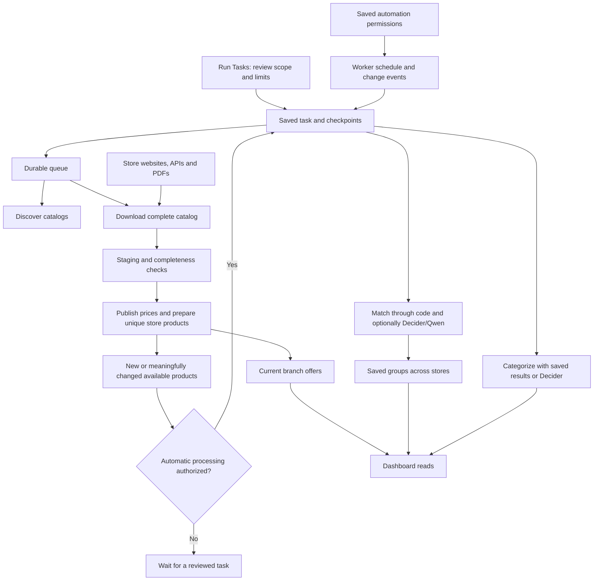

# Reading the MKD price aggregator

This guide follows the current application. Historical investigation documents record what was observed on their dates; they are not alternative execution paths.

## What runs

| Piece             | Responsibility                                                                   | Starting point                                                               |
| ----------------- | -------------------------------------------------------------------------------- | ---------------------------------------------------------------------------- |
| Web               | Dashboard, login, authenticated APIs                                             | [app/dashboard.tsx](../app/dashboard.tsx), [app/api/](../app/api/)           |
| Worker            | Execute authorized tasks and check schedules                                     | [worker/index.ts](../worker/index.ts)                                        |
| PostgreSQL        | Catalogs, prices, unique store products, connections, settings and audit records | [migrations/](../migrations/)                                                |
| Migration service | Apply numbered schema changes before startup                                     | [scripts/migrate.ts](../scripts/migrate.ts), [compose.yaml](../compose.yaml) |

The database lives in the PostgreSQL Docker volume. `.data/` contains ignored reports, screenshots and diagnostics. Environment files contain deployment credentials and are not committed.

A worker being online does not authorize an import, a paid request or historical processing. Its permissions come from saved operational settings and the scope captured when a task is reviewed.

## Vocabulary

| Name           | Meaning                                                                                                                   |
| -------------- | ------------------------------------------------------------------------------------------------------------------------- |
| Retailer       | One supermarket chain, such as KAM or SPAR.                                                                               |
| Source         | One published branch catalog, or a catalog explicitly shared by a chain.                                                  |
| Listing        | The original catalog's product record, retaining its source name and fields.                                              |
| Offer          | The latest published price and availability for a listing in a catalog.                                                   |
| Store product  | One unique product per chain, combining equivalent branch copies. This is the unit used for categorization and matching.  |
| Shared product | A group connecting the same exact sellable product across different chains.                                               |
| Task           | A reviewed scope, permissions, product/request/spending limits and durable progress.                                      |
| Run            | One catalog discovery or retrieval/publication checkpoint belonging to an import task.                                    |
| Brand          | A stable shared record, with alternate spellings used by stores. A brand alone does not prove two products are identical. |

An item may have prices from many physical branches without requiring repeated AI processing. Nine chains carrying the same item can form one shared product with up to one distinct current store product per chain.

## Reading one import

1. Start with [task-run-form.tsx](../app/_components/dashboard/task-run-form.tsx) and [task-review.tsx](../app/_components/dashboard/task-review.tsx). They display what will run before submitting a request.
2. [processes/api/tasks.ts](../nextsignal/processes/api/tasks.ts) authenticates and validates the request. [services/tasks.ts](../nextsignal/services/tasks.ts) saves its reviewed permissions and creates durable work.
3. [distributed/tasks.ts](../nextsignal/processes/distributed/tasks.ts) and [distributed/jobs.ts](../nextsignal/processes/distributed/jobs.ts) dispatch pending work. [import-dispatch.ts](../nextsignal/services/import-dispatch.ts) controls download/publication capacity, fairness and recovery.
4. [services/importers.ts](../nextsignal/services/importers.ts) finds catalog links and fetches their pages. [catalog-discovery.ts](../nextsignal/services/catalog-discovery.ts) handles store-specific discovery formats.
5. [services/http.ts](../nextsignal/services/http.ts) owns connection, response and idle timeouts. [source-health.ts](../nextsignal/services/source-health.ts) applies cooldowns for failing retailer hosts.
6. [services/parsers.ts](../nextsignal/services/parsers.ts) converts each site's fields into `CatalogRow`. Original source records remain in raw fields; names are not silently replaced by model guesses.
7. [catalog-repository.ts](../nextsignal/services/catalog-repository.ts) stages pages and publishes a complete catalog transactionally. Empty or substantially reduced catalogs require an independent confirming retrieval.
8. Publication updates current offers, removes offers absent from that successful catalog, and prepares durable store products. Saved product information, groups, corrections and decisions survive disappearing offers.
9. [task-automation.ts](../nextsignal/services/task-automation.ts) records permissions for changed products within the publication transaction. Matching never depends on opening or refreshing the dashboard.

Discover catalogs only finds links; it does not download every catalog's prices. The distinct Import prices task performs that work.

`offers` represents current prices, not an append-only price history. A failed catalog retrieval retains the previous publication.

## Categorization and matching

[task-products.ts](../nextsignal/services/task-products.ts) selects available unique store products within the reviewed task scope. Branch copies and price-only changes do not become additional products.

[matching-workflow.ts](../nextsignal/services/matching-workflow.ts) contains the shared product-processing stages:

- Read source text and supported facts.
- For categorization, reuse a saved answer or ask Perplexity Decider for a shared category.
- For matching, retrieve a bounded set of products from other chains.
- Apply deterministic evidence checks first. Optional AI comparisons use only the categories authorized for that task.
- Ask Qwen for targeted interpretation only when useful information exists in the source and clarification is permitted.
- Validate the complete proposed group before committing any connections.

[domain/matching.ts](../nextsignal/domain/matching.ts) contains product facts, compatibility rules and sufficient-evidence checks. [matching-repository.ts](../nextsignal/services/matching-repository.ts) owns persistence, candidate queries and transactional group commits.

[ai-gateway.ts](../nextsignal/services/ai-gateway.ts) is the single production AI client. It uses Vercel Gateway for Decider and optional Qwen calls, caches actual request inputs, reserves spending before requests and records provider receipts. [gateway-cooldown.ts](../nextsignal/services/gateway-cooldown.ts) handles shared cooldowns and a single recovery probe. Uncertain charges remain held rather than being blindly retried.

[task-context.ts](../nextsignal/services/task-context.ts) rechecks live permissions at safe boundaries. [task-cooldown.ts](../nextsignal/services/task-cooldown.ts) resumes eligible automatic tasks after temporary Gateway failures. Explicit pauses and spending limits remain effective.

Read [category-first-matching.md](category-first-matching.md), [task-controls.md](task-controls.md) and [matching.md](matching.md) for the corresponding rules and operational behavior.

## Brands and readable names

[brands.ts](../nextsignal/services/brands.ts) manages database brands and spellings with revisions and audit records. [brand-catalog.ts](../nextsignal/services/brand-catalog.ts) supplies dictionary snapshots to processing code. [reference-data/brands.json](../reference-data/brands.json) documents the starter dictionary; it is not a competing live configuration source.

Products retain source-supported brand facts and connect those facts to stable brand IDs. Unknown or conflicting brands remain unresolved. Renaming a display label must not change product identity or trigger a full paid categorization pass.

[domain/name-encoding.ts](../nextsignal/domain/name-encoding.ts) decodes source character encodings such as `^ → Ч` and `[ → Ш`. [domain/product-text.ts](../nextsignal/domain/product-text.ts) produces readable display/request text while preserving brands and model codes. These are input-format rules, not retired application compatibility paths.

[domain/local-matching.ts](../nextsignal/domain/local-matching.ts), [domain/product-facts.ts](../nextsignal/domain/product-facts.ts) and [domain/pack-count.ts](../nextsignal/domain/pack-count.ts) keep tested naming, quantity and packaging rules separate from mutable brand reference data.

## Manual and agent review

| Area                                 | Code                                                                                                                                     |
| ------------------------------------ | ---------------------------------------------------------------------------------------------------------------------------------------- |
| Category review queue and scores     | [category-review.ts](../nextsignal/services/category-review.ts), [product-categories.ts](../nextsignal/services/product-categories.ts)   |
| Manual connections and separations   | [manual-matching.ts](../nextsignal/services/manual-matching.ts), [manual-match-memory.ts](../nextsignal/services/manual-match-memory.ts) |
| Editable product details and history | [product-details.ts](../nextsignal/services/product-details.ts)                                                                          |
| Bounded WebMCP agent sessions        | [agent-category-review.ts](../nextsignal/services/agent-category-review.ts), [lib/webmcp.ts](../lib/webmcp.ts)                           |
| Review presentation                  | [app/_components/dashboard/category-review.tsx](../app/_components/dashboard/category-review.tsx)                                        |

Manual and agent actions are attributed and saved. Agent batch acknowledgment hides old results in the interface without deleting decisions or undo history. These operations do not call an AI provider merely to save a label.

## Settings and observability

Operational settings live in PostgreSQL with revisions and change history. [task-settings.ts](../nextsignal/services/task-settings.ts) owns reads, saves, schedule previews and readiness. Deployment defaults seed a missing record once and do not overwrite saved choices on restart.

[config/default.json](../config/default.json) and [nextsignal/config.ts](../nextsignal/config.ts) contain required deployment settings. Database credentials, API keys, endpoints and prompt file paths belong there or in root environment overrides. Paid workflow permissions, schedules and reviewed allowances belong in Tasks settings.

[adapters/log-context.ts](../nextsignal/adapters/log-context.ts) carries process/run/task context into the logging adapter. [adapters/logger.ts](../nextsignal/adapters/logger.ts) redacts secrets, persists logs and spools during database outages. Results are readable in Tasks and Review; request-by-request diagnostics use debug logs.

[product-statistics.ts](../nextsignal/services/product-statistics.ts) refreshes saved dashboard aggregates in the worker. [dashboard-read.ts](../nextsignal/services/dashboard-read.ts) and [product-browser.ts](../nextsignal/services/product-browser.ts) serve bounded read queries. A browser refresh does not start imports or model requests.

## Folder map

| Folder                       | Responsibility                                                                                    |
| ---------------------------- | ------------------------------------------------------------------------------------------------- |
| `app/api/`                   | Thin route handlers dispatching named processes.                                                  |
| `app/_components/dashboard/` | Dashboard UI, client-safe types and API interaction.                                              |
| `components/ui/`             | Shared shadcn components.                                                                         |
| `nextsignal/processes/`      | Auth, validation, lifecycle and business orchestration.                                           |
| `nextsignal/services/`       | SQL repositories and external provider boundaries.                                                |
| `nextsignal/domain/`         | Pure rules and shared contracts.                                                                  |
| `nextsignal/adapters/`       | Logging, authentication, validation, queues and scheduling infrastructure.                        |
| `prompts/`                   | Reviewed AI and agent instructions, separated by task/store/product family.                       |
| `reference-data/`            | Starter reference dictionaries used to initialize persisted data.                                 |
| `migrations/`                | Applied schema history. Keep existing migrations; add changes with new migrations.                |
| `tests/`                     | Isolated database tests, domain tests and captured fixtures. `tests/helpers/` is test-only setup. |
| `worker/`                    | Separate background runtime.                                                                      |
| `scripts/`                   | Explicit maintenance, evaluation and verification entry points.                                   |

## Commands

| Command                     | Behavior                                                                                                     |
| --------------------------- | ------------------------------------------------------------------------------------------------------------ |
| `npm run check`             | Type-check the application.                                                                                  |
| `npm run build`             | Compile production web output.                                                                               |
| `npm test`                  | Migrate and test an isolated database with provider calls disabled or mocked.                                |
| `npm run smoke`             | HTTP authentication/read/validation checks; starts no valid tasks.                                           |
| `npm run browser:smoke`     | Browser checks against seeded data. Task acceptance is mocked and a catch-all guard blocks other API writes. |
| `npm run coverage`          | Read import coverage and generate diagnostics.                                                               |
| `npm run ingest -- <store>` | Create an explicitly authorized import task using saved operational settings.                                |
| `npm run run -- <run-id>`   | Execute an already authorized catalog run; held or unauthorized work remains held.                           |
| `npm run matching:evaluate` | Use the isolated matching evaluation database; paid calls require an explicit paid option.                   |
| `npm run setup`             | New checkout only; refuses to overwrite an existing environment file.                                        |

Maintenance scripts under `scripts/repair-*` are deliberate local corrections for a specific diagnosed issue. They do not run on application startup. Use them only when their stated preconditions and effects match the intended operation.
