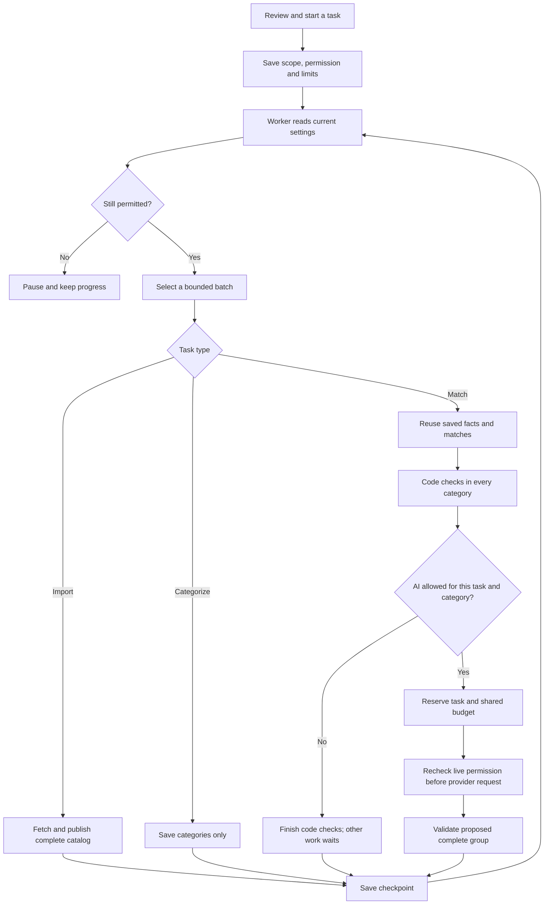

# Tasks and gradual activation

A new deployment is quiet. Imports, categorization and matching start in **Manual only** mode; AI and Qwen clarification are off. No stores are scheduled. Starting the worker does not authorize imports, matching or AI calls.

## Using the dashboard

The sidebar has separate Run Tasks and Settings pages, with a secondary history panel in Settings:

- **Run Tasks** (play icon in the sidebar): a left-hand task menu, ordered Discover catalogs → Import prices → Categorize products → Run matching, with the selected task’s explanation and form on the right. Selection never starts work. Small screens use a compact task selector. Pause/resume work and worker status belong to this page only. Choose a scope and review the task before starting. Product tasks default to 50 unique products per chain, rather than 50 branch observations. Switching task types resets AI matching, all-pending, recheck and product/spending limits to the small saved defaults. “All pending” is an explicit selection. Imports always publish complete catalogs.
- **Settings** (gear icon in the sidebar): the same left-menu/right-panel layout for Automation, Import schedule, Matching & AI, Spending, and Advanced. Only one section is shown at a time. Draft edits are retained when changing sections. History sits in the page header; Save changes and Discard appear beside it only while editing. There is no saved-status bar or pause/resume control on Settings. Spending and model details live in their relevant sections.
- **History:** a small secondary action in the Settings header opens a side panel with paginated account/time/before-and-after changes. The log adapter also records changes and task authorization/checkpoint/pause events.

Fresh imports automatically create the store-product records needed by categorization and matching. There is no preparation task or backfill command; a fresh production database starts directly with imports. Tasks do not silently convert records from older data formats.

Manual AI matching requires saved categories and uses the categories selected for that run. It never secretly categorizes more products. Uncategorized products remain waiting. Categorization does not perform matching. Code-only matching is available in every category and completes without AI permission.

The **Match automatically after imports** switch is linked to the Product matching mode. Turning it off selects Manual only, stopping both code-based and AI matching after imports without clearing the category list. Turning it on selects Automatic; AI still requires its separate permission. Save settings to apply the change.

The automatic category list is separate from each manual task's selection. Removing categories or increasing probability thresholds can tighten an automatic task already in progress. Increasing permissions never expands a reviewed manual task.

## Stored permission and safe stopping

`operational_settings` is the shared PostgreSQL record. Required values in `tasks.defaults` seed a missing record once; startup never overwrites saved choices. Saves require the current revision. History is append-only.

Each `task_executions` row stores its origin, account, reviewed revision, policy, scope, product count, AI choice and lifetime allowance. `task_items` stores selected products and checkpoints. The limit spans every batch and restart, including cached calls and follow-up work. Pending work outside the selected scope stays waiting.

The worker checks global pause, operation mode, task state and AI permission before source/provider requests and at product/page checkpoints. An already in-flight request or database transaction can finish. Turning an operation to Manual only stops automatic work; reviewed manual tasks may continue. Off blocks both. Explicit resume keeps the original scope and spending history.

Automation grants carry activation numbers. Only newly published product changes receive the permissions captured by their import and still allowed at publication. Enabling automation/AI/categories never marks the existing backlog as authorized. New branch copies and price-only updates reuse the existing product and do not create a new AI grant. Legacy queue deliveries without a task authorization are acknowledged as held, rather than executed.

## Budgets

Each paid request reserves estimated cost before being sent and records the owning task. Task-wide request/cost caps and shared initial/monthly caps all apply. Initial tasks share one initial ledger; separate batches/tasks cannot each obtain another $25. Monthly incremental spending uses Europe/Skopje calendar months. The initial cutoff is saved when the first explicit product task establishes the initial campaign; products already present belong to that initial pass.

Reservations for uncertain provider billing remain charged until reconciled. Explicitly unsent or rejected requests release their reservation. Resume and settings changes do not reset usage. Raising a saved limit cannot increase the limit captured by an existing task; start another deliberately reviewed task if necessary.

## Schedules and recovery

The import schedule is one five-field cron expression in Europe/Skopje. Changes calculate the next future occurrence. Catch-up defaults off; when enabled, a delayed scheduler authorizes at most one import per selected store, with concurrent schedulers serialized in PostgreSQL. Existing active/paused scheduled imports prevent another catch-up for that store.

The separate worker publishes a shared database heartbeat; the existing file heartbeat still supports its container health check. Restart recovery only touches previously authorized unfinished tasks and runs, using advisory locks. It does not release legacy jobs, reset completed products, or perform indexing.

## Module map

- `nextsignal/domain/task-settings.ts`: strict policy/command schemas and client-safe types.
- `nextsignal/services/task-settings.ts`: settings persistence, revision checks, history, schedule previews and health/readiness.
- `nextsignal/services/task-context.ts`: async task context, live permission checkpoints and captured matching configuration.
- `nextsignal/services/tasks.ts`: task authorization/control, import orchestration, scheduling and recovery.
- `nextsignal/services/task-products.ts`: bounded product selection, revision checkpoints and product-stage execution.
- `nextsignal/services/task-automation.ts`: transaction-owned permission grants for newly published products and future manual detail corrections.
- `nextsignal/processes/api/tasks.ts`: authenticated settings/task API processes.
- `nextsignal/processes/distributed/tasks.ts`: durable task delivery.
- `app/_components/dashboard/tasks.tsx`: Tasks tabs and activity.
- `app/_components/dashboard/task-run-form.tsx`: scoped manual task forms and category availability.
- `app/_components/dashboard/task-picker.tsx`: ordered task boxes, descriptions and keyboard-accessible selection.
- `app/_components/dashboard/task-settings-form.tsx`: grouped operational forms with one shared draft and sticky save controls.
- `app/_components/dashboard/task-settings-history.tsx`: audit history loaded on demand in a side panel.
- `migrations/020_configurable_tasks.sql`, `021_task_worker_health.sql`: additive authorization/settings/checkpoint schema; no backfill or provider activity.

API routes: `GET/PATCH /api/task-settings`, `GET /api/task-settings/history`, `GET /api/task-settings/schedule`, `GET/POST /api/tasks`, `POST /api/tasks/control`, `GET /api/tasks/categories`. Import/matching/categorization starts require a reviewed task command; old unreviewed request bodies cannot bypass the new controls.

API keys, database credentials, provider endpoints, model/prompt files and product-safety rules remain deployment/code settings. The Tasks UI never edits or displays those secrets.

Reviewed manual starts and resumes publish their own task to the durable queue
immediately. They do not wait for the minute scheduler or dispatch unrelated
waiting tasks. If queue publication fails, acceptance remains saved and its
lease is released so a later scheduler tick can recover it. Worker pickup still
uses the configured queue polling interval (one second by default).

Categorization and matching queue the next batch immediately after saving a
checkpoint, within the same authorized task. They do not wait for the minute
scheduler between batches. The product limit is the total for the task, while
the batch size controls only each worker delivery. For example, a 50-product
task stops after 50; an explicit all-pending task continues in batches of 50.
Each product result is durable as it finishes. Imports waiting on catalog work,
paused/failed/completed tasks and unrelated pending tasks cannot be continued by
this path. Live permission and task-wide budget checks still run before work.
Atomic dispatch leases prevent simultaneous dispatch claims; the regular scheduler
remains the recovery path if publishing a continuation fails.

Verification on 25 October 2026: all 456 isolated tests and the production build
passed. The worker was replaced after the existing KAM categorization task saved
its 500-product checkpoint. Its options, captured policy, permissions and live
settings remained identical; the previously paused task stayed paused. An
observed production batch then finished and the next started 0.077 seconds
later, compared with 34–43 seconds of idle time before the change. No new task
or separate live provider test was started for verification.

Worker limits separately control overall catalog downloads and downloads from
each chain. New tasks default to two overall and two per chain. Complete downloads
release that capacity and enter a bounded ready queue; one final database save is
allowed at a time. Existing task limits remain unchanged unless the resume/retry
dialog explicitly reviews the current limits. That adoption has its own audit row
and never expands the selected stores or AI/spending permissions.

The Tasks table refreshes after a command is accepted and returns to its first
page for a newly created task. Discovery progress shows completed stores against
the selected store count; import progress counts successfully imported catalogs;
product tasks show products checked, with connection counts only for matching.
Unlimited product tasks show a processed count rather than “all pending” as a
numeric denominator.

An import cannot start or resume across stores/catalogs already covered by another
queued/running import. The check is transactional across hosts and keeps exact
idempotent replays valid. Different catalogs of one chain can still run as separate
scoped tasks; paused tasks must recheck overlap before resuming. Scheduled imports
skip currently occupied stores without preventing other selected stores from running.

Active reviewed imports/discovery tasks offer **Retry failed** when needed. The
review shows only affected stores, and the command cannot expand that selection.
It gives their failed leaves a new bounded retry cycle inside the original task,
keeping successful catalogs, task limits, prices and current work. A rejected
complete snapshot restarts from fresh data; ordinary failed downloads retain saved
pages. The permission check, failure counts, failure reason and retry candidates
follow the same confirmation/replacement history. Historical failures are kept.

Task-list reads derive unresolved failure labels from current history, so old
resolved quarantine warnings cannot hide the actual failed store.

Run Tasks and Settings have separate sidebar entries and URLs (`?screen=tasks` and
`?screen=settings`). Settings history is available only from Settings. Opening
Settings reads operational settings without fetching task-activity pages.

The two pages share `workspace-sections.tsx` for section navigation and
`page-actions.tsx` for compact header controls. Header Save is explicitly associated
with the settings form, preserving validation, stale-save protection, and audit
logging. Run Tasks retains the review dialog before a task can be started. Task
activity only shows pagination when more than one page exists.

Data updates and logs share the **Observability** sidebar entry, with separate
Data updates and Logs tabs. Each tab remembers its own filters and page during
navigation. “View data updates” task links select the updates tab; “View related
logs” links open Logs scoped to that update. Shared URLs use
`?screen=observability&tab=updates` or `?screen=observability&tab=logs`.
Existing `screen=updates` and `screen=logs` bookmarks open the corresponding tab
and are rewritten to the new URL without adding an extra browser-history entry.
Opening Observability only reads data; it does not start or resume any work.
